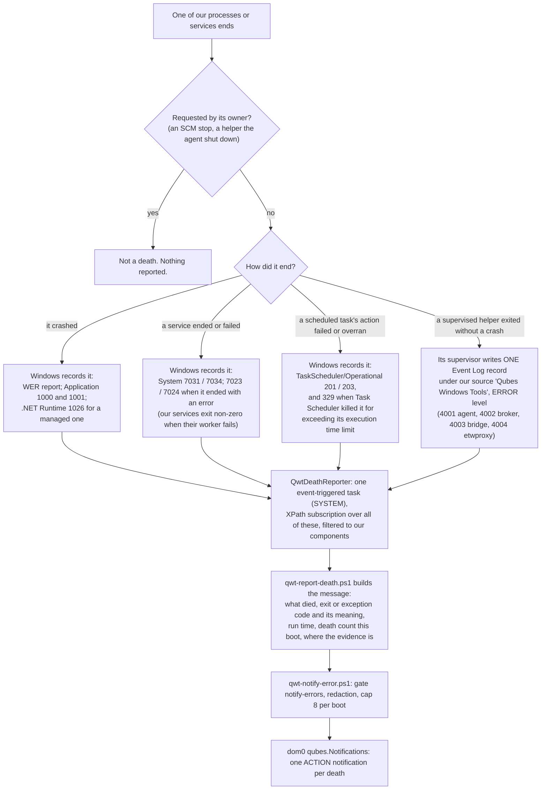

# ADR - supervision: how our components are kept alive, and how their deaths are made loud

## In plain English

When one of our programs or services crashes or quits without being asked, that is a serious error, and the
person using the qube must see it. It is not a warning line buried in a log while a watchdog quietly restarts
the program. Every such death is logged as an error and reported to dom0 as a notification, every time,
counted, up to a storm cap of eight per boot.

Deaths are detected from the records Windows already keeps: crash reports, service-failure events, scheduled-
task failures. We do not write our own watchdog scripts. The one case Windows cannot see, a helper exiting
cleanly but unexpectedly, is written by its supervisor as a single event in the same log. One scheduled task
subscribes to all of those records and sends the one notification, which says what died, the error code and
its meaning, how long the program had run, how many deaths this boot, and where the evidence is.

Restarts use the operating system's own recovery. Every service we install has recovery actions. Helpers are
launched once per agent life through a scheduled task; its restart settings retry only a launch that failed
(measured 2026-11-13, §4), so a helper that ran and died stays down until the next agent start - nothing of
ours relaunches it (rule 3 below). The GUI agent keeps its small watchdog service, because starting a
system-privileged process inside the user's session is the one job nothing in Windows does for us. There are
no polling loops and no kill loops: a state that must hold is configured at its source. All of this was built
on 2026-10-03. What remains is to demonstrate the chain on a real guest with a forced crash.

The whole chain, from a death to the notification in dom0 (§1-§4):

## The decisions at a glance

| § | decision | status | date |
|---|---|---|---|
| 1 | Anything of ours that dies unexpectedly is a major ERROR, and it is LOUD | ACCEPTED (owner; Jev 0.74) | 2026-10-03 |
| 2 | Detection uses the system's own records | ACCEPTED (owner; Jev 0.86) | 2026-10-03 |
| 3 | ONE reporter, and the notification is ours | ACCEPTED (owner) | 2026-10-03 |
| 4 | Restarts use system recovery; a supervisor service only where nothing else can do the job | ACCEPTED (owner; Jev 0.99) | 2026-10-03 |
| 5 | Nothing of ours relaunches anything: an exit code is a contract, the relauncher is disarmed before its target is ended, and a loud error the user must see reaches them even when dom0 cannot be told | ACCEPTED (owner) | 2026-10-07 |
| 7 | A deliberate stand-down is ultimate: no clock, no deadline, no report, until something starts it | ACCEPTED (owner) | 2026-10-24 |
| 8 | A supervisor may POLL to detect, but only on a handle it owns, and it may not restart | ACCEPTED (owner) | 2026-10-24 |
| 9 | The channel that ASKS a child to exit is created by its OWNER, before the child runs | ACCEPTED (Jev 0.96) | 2026-11-06 |

(Section 6 is a recorded FINDING, not a decision, and keeps its number.)

Status words and the section format are defined in `docs/ADR-README.md`.

---

## The decisions in detail

Where the details live:

| record | content |
|---|---|
| `docs/DESIGN-error-notify.md` | the error-notify route (`service.notify-errors`) that carries the death notification |
| `guest/qwt-report-death.ps1`, `guest/qwt-notify-error.ps1` | the reporter's action and the route it sends through |
| `include/deathevent.h` (agent) | the one Event Log record a supervisor writes per death |
| `winutils/src/service.c` (until 2026-11-07 `patches/windows-utils-service-exit-code.patch`) | services exit non-zero when their worker fails |
| `guest/health-check.ps1` (step 2b) | asserts every service's recovery settings |
| `tools/tests/death-reporter-*`, `svc-exitcode-selftest.sh`, `health-recovery-selftest.sh` | the offline proofs |
| `findings/issues.md` | what is still owed on a guest |

## 1. Anything of ours that dies unexpectedly is a major ERROR, and it is LOUD

**Status:** ACCEPTED (owner; Jev 0.74 with the owner's rule as premise), 2026-10-03.

**Context.** On 2026-10-03 a GUI agent crash (fast-fail `0xC0000409`) sat in Windows Error Reporting on a test
guest. The watchdog's single warning line was the only other trace. The owner: "anything that dies unexpectedly
should signal LOUD" and "it is not fucking warning! it is a major error!". A relaunch that only writes a warning
line hides the failure. That is exactly the shape this project's rules forbid for fallbacks and for components
that stop working.

**Decision.**

1. Every unexpected death of one of our processes or services is an **ERROR** in our own logs, never a warning.
2. Every death is an **ACTION** notification to dom0, each one counted. A second death in the same boot is a
   second notification, never hidden by de-duplication. The existing per-boot storm cap (eight) still bounds a
   crash loop; past the cap every death is still logged as an ERROR.
3. This applies to the GUI agent, to every helper a supervisor relaunches (the WGC broker, the notification
   bridge, etwproxy), and to every service we install.
4. "Unexpected" means not requested by the component's owner. A service stop the service manager asked for, or
   a helper the agent shut down, is not a death.
5. A relaunch still follows where the GUI or a channel must come back. It is never a quiet recovery again.

## 2. Detection uses the system's own records

**Status:** ACCEPTED (owner; Jev 0.86), 2026-10-03.

**Context.** The owner: "use system mechanisms, not ad hoc watchdog scripts". Windows already records every
kind of death we care about, on every install, at no cost, in records the platform's own tooling trusts.
Per-component reporting code would be a second, partial, inconsistent copy of them.

**Decision.** A death is detected from the record Windows already writes:

| what died | the system's own record |
|---|---|
| any of our processes CRASHED | Windows Error Reporting; Application log 1000 (faulting application and exception code) and 1001; `.NET Runtime` 1026 for a managed one |
| any of our services ended unexpectedly | System log 7031 / 7034; 7023 / 7024 when it ended with an error |
| a scheduled task's action failed | TaskScheduler/Operational 201 (non-zero return code), 203 (launch failed) |

Two rules make the records complete:

1. **The one death the system cannot see** - a process one of our supervisors started exits without crashing,
   and nobody asked it to - is written by that supervisor as **one Event Log record** under our own registered
   event source. The supervisor writes nothing else. The supervisors today are the GUI watchdog for the agent,
   and the agent for its broker, bridge and etwproxy.
2. **Our services make their failures visible to the service manager.** A worker failure ends the service with
   a **non-zero exit** or a service-specific error, so 7023/7024 and the SCM's recovery fire. At decision time
   QdbDaemon and QrexecAgent ended with exit code 0 when their worker failed, which is invisible; fixed, see the
   implementation notes.

## 3. ONE reporter, and the notification is ours

**Status:** ACCEPTED (owner), 2026-10-03.

**Context.** The owner: "notification that hits user screen should be ours ... for the rest, no kolkhoz
solutions". The alternatives were weighed: a toast inside the guest is invisible in seamless mode, and dom0 has
no other per-qube health surface.

**Decision.**

1. A single **event-triggered scheduled task** subscribes, with an XPath query, to every record in §2, filtered
   to our components.
2. Its action sends **our** dom0 notification through the error-notify route: `qubes.Notifications`, gated by
   `notify-errors`, with its per-boot cap.
3. The notification carries what died, the exit or exception code with its meaning when known, how long the
   component had run, the death count this boot, and where the evidence is (the WER report, the log).
4. No component sends its own death notification.

**Why.** One reporter gives one message format, one place to gate, cap and de-duplicate, and one thing to test.
The trigger is the system's own event delivery, not a poll.

## 4. Restarts use system recovery; a supervisor service only where nothing else can do the job

**Status:** ACCEPTED (owner; Jev 0.99), 2026-10-03.

**Decision.**

| component | how it comes back |
|---|---|
| every service of ours: QdbDaemon, QrexecAgent, QubesGuiWatchdog, QwtngNetSetup | **SCM recovery actions**, with `failureflag` so that non-crash failures count too. At decision time only the first two were armed. |
| task-launched helpers | **SUPERSEDED by §5 (2026-10-07).** At decision time: Task Scheduler's restart settings where its interval fits, and the agent's own bounded relaunch where it did not. The owner withdrew that exception - the agent keeps no relaunch loop at all. |
| the GUI agent | stays under the **QubesGuiWatchdog service**. That is the one job no system mechanism does: starting a SYSTEM-token process inside the user's interactive session. The watchdog service itself is SCM-recovered. |

Rules that follow:

- **No ad hoc watchdog scripts, no polling loops, no kill loops** (process ownership: `docs/ADR-updater.md`
  §12.4).
- A state that must hold is configured at its source: a service start type, a policy, a task setting. It is
  never re-enforced by killing.

**Why.** The platform's recovery is documented and observable (7031 says which action it took), and it survives
our own bugs. Each hand-written relaunch loop is one more thing that can fail quietly.

---

## 5. Nothing of ours relaunches anything; an exit code is a contract; the relauncher is disarmed first

**Status:** ACCEPTED (owner), 2026-10-07. Jev on the parts: the keep-alive owner 0.55, the session-end
mechanism 0.67, the one reconnect relaunch 1.0, the helper loops 1.0 (then overridden by the owner, below),
the guest error window's mechanism 1.0, the installer fix shape 0.89.

**What was measured, 2026-10-07.** On every shutdown of a 4.3.35 guest, Windows' session teardown terminated
the GUI agent with `0x40010004` 33-826 ms after the shutdown began, and the watchdog service relaunched it
13 ms-1 s later **into the session that was being torn down**; that instance was killed too, and a third
lived until the service's own preshutdown notice. Three agent instances per shutdown, two of them killed,
each one a vchan setup with dom0 and an `Application` 4001 death record. The guard written in August to
prevent exactly this read `SM_SHUTTINGDOWN` from a session-0 service, which reports session 0: it logged
`sm_shuttingdown=0` at every death and was never once seen to fire, while `SERVICE_CONTROL_PRESHUTDOWN`
arrived 4-32 s too late. A terminated agent runs no cleanup, so its vchan announcement stayed in xenstore -
which is what dom0's "(0:0) outdated protocol" dialog reads. None of it was hidden: it was logged at ERROR on
every boot for weeks, and nobody read the logs between runs.

The owner, on seeing it: *"OF FUCKING COURSE if you terminate something that relaunches you need to make sure
it STOPS relaunching beforehand"*, *"i asked you to rely on windows system services if we need to keep smth
running"*, *"we agreed that broker death is major failure anyway, so there is no point of making it extra
smooth"*, and - of the other components - *"same of other components."*

**Decision.**

1. **An exit code is a contract.** `WinMain` returns `QGA_EXIT_REQUESTED`, `QGA_EXIT_SESSION_END`,
   `QGA_EXIT_RECONNECT` or `QGA_EXIT_NO_GUI_DOMAIN` on the paths it decides, never a stale `GetLastError`, and
   the service decides what to do from that code alone. An expected exit is logged at INFO with its reason; a
   failure at ERROR with the code that caused it. No ERROR line is written on a path the service asked for.
2. **The session end is a handshake, not a surprise.** The agent's first act - before `Init` - is to create a
   hidden top-level window. On `WM_QUERYENDSESSION` it disarms its helper launches, tells the service the
   session is ending and waits, bounded, for the service's acknowledgement; on `WM_ENDSESSION(TRUE)` it leaves
   through its orderly exit (vchan closed and its announcement withdrawn, helpers told to leave) with
   `QGA_EXIT_SESSION_END`; `WM_ENDSESSION(FALSE)` re-arms. The service never launches into a session that has
   announced its end, and a `0x40010004` with no such notice is read as the system's own record of that
   session ending - loud, and still no relaunch into it.
2b. **THE PREDICATE IS THAT THE SESSION IS GOING DOWN, NOT THAT IT ANNOUNCED IT.** Clause 2 says the service
   never launches into a session "that has announced its end", and §7 below describes the case that breaks
   that wording outright: the shutdown is announced, another application vetoes it, and *the agent dies before
   it can say so*. A session can therefore be going down with no announcement on record, and every launch site
   that keys on the announcement starts a process into a dying session. The condition a launch site must refuse
   on is the session going down, however that became true - announced, vetoed-then-resumed, or witnessed only
   by a process that is already gone.
   **The carrier is a named kernel event created `OBJ_PERMANENT` by the LocalSystem service**, chosen because
   the fact must outlive the process that observed it (Jev `permanent_named_object` 0.88,
   `latch_names_the_session` 0.88). MEASURED on a win11 guest (build 10.0.26300.9457, PS 5.1.26100.9444),
   both sides and the teardown, as SYSTEM with `SeCreatePermanentPrivilege` **Enabled**:

   | leg | result | what it establishes |
   |---|---|---|
   | open a name never created | `0xC0000034` | the check can fail, so the others are not decoration |
   | create WITHOUT `OBJ_PERMANENT`, creator exits, reopen | `0xC0000034` | the control: the name dies with its creator, so nothing else retains these names |
   | create WITH `OBJ_PERMANENT`, creator exits, reopen | `0x00000000` | the fact survives the process that recorded it - the whole reason for this carrier |
   | reopen again | `0x00000000` | stable, not a one-shot |
   | `NtMakeTemporaryObject` + close, then reopen | `0x0`, `0x0`, `0xC0000034` | the latch can be RELEASED deliberately, and leaves nothing behind |

   **IMPLEMENTED FOR THE SERVICE'S LAUNCH ONLY (2026-11-06).** The latch exists, with its three operations in
   `agent/include/qga-lifecycle.h` - the shared header, because the agent and the service share no source
   file - and five call sites:

   | site | file | what it does |
   |---|---|---|
   | set | `gui-agent/lifecycle.c`, `WM_QUERYENDSESSION` | publishes the agent's OWN session, beside `HelpersDisarm`, **before** the bounded ack wait, so it holds when Windows terminates the agent inside that wait |
   | adopt | `watchdog/watchdog.c`, the launch guard | a held latch is adopted into `endedSession`/`endedSessionAt`, the same two variables the channel sets |
   | release | `gui-agent/lifecycle.c`, the veto path | the end was cancelled; the agent is the one process that learns this with no service in the path |
   | release | `watchdog/watchdog.c`, `SESSION_END_NEVER_HAPPENED_MS` | the publisher died inside a vetoed end - the only recovery for that case |
   | release | `watchdog/watchdog.c`, the logoff arm | the session is no longer *going* down, it is down |

   The adopt arm deliberately does **not** refuse in parallel with clause 2's `endedSession` check. It feeds
   that one check instead, so the refusal, its log line and - decisively - the stuck-session recovery stay in
   one place. A second refusal arm with no timer behind it would have left a guest with no GUI until it
   rebooted, which is worse than the defect being fixed. For the same reason `QgaGoingDownHeld` answers three
   values and only `1` refuses: a latch that cannot be READ is not a latch that is held.

   **STILL NOT WIRED:** the other launch sites. There are ~15, not nine as this entry first said
   (`watchdog.c:296`; `etwproxy.c:880`; `main.c:2754`, `:2825`, `:6745`; `notifyerr.c:468`;
   `notifhost.cpp` ×7; `qrexec-wrapper.c:387`), and they are not a single decision: `qrexec-wrapper` serves
   dom0's requests rather than our own supervision, and `notifhost` runs under the **interactive user's** token,
   not SYSTEM (`main.c:4669` launches it "inside the interactive user session"; `main.c:6558` "uses the SESSION
   token"), so it cannot open a SYSTEM-only object at all. Widening the DACL is the gate on that scope and it
   has not been asked for. Until then those sites behave exactly as before.

   **RUNNER: supervision-e2e L12**, added 2026-11-08, with `L12C` (the control) and `L12R` (the release
   half). `guest/sup-goingdown-latch.ps1` (2026-11-07) is the in-guest half: it publishes the latch from a
   child that EXITS before the guard reads it, ends the agent, reads the refusal, releases, and has a
   `-Control` arm that performs the identical kill with no latch published. Its instrument is validated
   before the stimulus by `pre_open`, which must read `0xC0000034`, and its four graded tokens all have
   producers in `watchdog/watchdog.c`. It was committed on 2026-11-07 and **called by nothing** for a day -
   the gap had moved from "no script" to "no caller" - which is why the cell, not the probe, is what closed
   item 2b's RUNNER.

   **MEASURED 2026-11-08 on win11r-sup** (`qwt-sup/20261108T025009Z-2338742`, reproduced in
   `…T025645Z-2341311`, `…T030218Z-2342974` and the full suite `…T030912Z-2345074`): the refusal half holds. The latch was published by a child that exited
   (`publisher_running=NO`) and the name still opened (`held_after_publish=0x00000000`); the guard **adopted
   it** (`QGAWDGOINGDOWN`, `adopt_ms=15338`), **said so** (`QGAWDNOLAUNCH` ×1 on this run, ×0 on the other three - the count races its writer, so the refusal is witnessed by the adopt and the silence after it, never by this line) and **launched nothing while
   it was held** (`agent_pid_during=NONE`), against a control arm whose identical kill produced
   `adopt_lines=0` and an agent back. `pre_open` read `0xC0000034` first, so the negative reading is known
   to be reachable.

   **THE RELEASE DOES NOT WAKE THE GUARD, and this entry's release-site list overstates what it does.** The
   deliberate release withdrew the object (`release_status=0x00000000`, `held_after_release=0xC0000034`)
   33 ms after the adopt, yet no agent returned until `relaunch_ms=106543` - `15338 + 90000 = 105338`, one
   poll LATER, never before it - and the SAME SHAPE ON ALL FOUR RUNS: adopt 15338/60307/60390/15355 against relaunch 106543/151235/151309/106422, i.e. 1205/928/919/1067 ms AFTER `adopt_ms + 90000` and not once before it. The cause is in
   this file's own design: the guard tries `consoleSession == endedSession` (`watchdog.c:632`) **before**
   `QgaGoingDownHeld` (`:641`), and the adopt branch says it outright - "The next pass takes the arm above".
   So once adopted the latch is unreachable, and only a real session end (`:794`, `:815`) or the 90 s
   recovery (`:753`) clears the refusal. "Released on the agent's veto path", above, can therefore only
   shorten a hold the guard has **not yet adopted**. Whether the product owes a shorter hold is **UNDECIDED**:
   Jev `release_must_shorten_the_hold` 0.44, and 0.20 on a licensed re-ask carrying those source arms
   (timer-is-the-only-exit 0.47 against guard-must-reread 0.46). It is neither filed as a defect nor excused,
   and a third ask needs new evidence rather than rewording.
   **THE REMAINING SITES, AND WHY EXTENDING THIS LATCH IS NOT THE FIX** (measured 2026-11-08 from the
   sources, not from the issue text). The DACL constrains the READER - the process that opens the latch
   before launching - never the token the child gets, so the thirteen other sites split 7/7:

   | reader runs as | sites | can it open `D:P(A;;GA;;;SY)`? |
   |---|---|---|
   | SYSTEM | `watchdog.c:296`; `gui-agent/etwproxy.c:880`, `notifyerr.c:468`, `main.c:2754`, `:2825`, `:6745`; `qrexec-wrapper.c:387` | yes, today, with no DACL change |
   | the interactive user | `tools/notifhost/notifhost.cpp` x7 | no |

   The watchdog duplicates its OWN SYSTEM token and only retargets the session (`:272`-`:296`), which is why
   every gui-agent site is SYSTEM too - the three `main.c` sites call `CreateProcessAsUser`, but that sets the
   CHILD's token, not the reader's. qrexec-wrapper is SYSTEM because `WTSQueryUserToken` (`:323`, `:433`)
   requires SeTcbPrivilege and it runs services as SYSTEM (`:575`). notifhost is a separate exe put into the
   interactive user session by `HelperTaskRegister` ("the same interactive-user launch as WgcLaunch ... a full
   user context", `main.c:4670`), so its seven sites are refused by the DACL; widening it has not been asked
   for and is a separate, isolation-weakening decision.

   **The gui-agent is the process that SETS the latch** (`gui-agent/lifecycle.c`, WM_QUERYENDSESSION), so at
   its five sites the would-be reader IS the writer. Asking a kernel object what this process just recorded
   buys nothing: the object exists so the fact OUTLIVES the process, a property only another process needs.
   Jev `writer_reading_its_own_object` = `local_flag_is_correct_there` 0.80 at **conf 0.73 - above floor, and
   the only verdict in this scoping**. A process-local going-down flag is the mechanism there.
   `remaining_sites_scope` has **NO verdict** at conf 0.32, but it is not empty: `all_seven_system_side`
   scored **0.00** and `the_four_helper_sites_only` 0.08, while the two survivors are a dead heat -
   none-until-a-recovery-exists 0.46 against local-flag-for-the-gui-agent 0.45. Both survivors say the same
   thing about the latch, and the counter-fact driving them is that **a refusal needs a recovery behind it**:
   the watchdog's guard is folded into the existing endedSession arm precisely because the 90 s
   `SESSION_END_NEVER_HAPPENED_MS` timer lives there, and a parallel refusal arm with no timer behind it
   would strand a guest with no GUI until reboot - worse than the defect. None of the other sites has one.

   **THE STRANDING OBJECTION DOES NOT REACH THE FIVE, AND THE DECISION IS STILL NOT RIPE.** Read out of the
   sources afterwards: all five gui-agent sites spawn HELPERS, never the agent - `SpawnHelperAsUser`
   (`main.c:2732`), `SpawnHelperInSession` (`:2778`), `RestyleGuestCaption` (`:6675`, the caption helper),
   `notifyerr.c:468` (whose next line reads "fire and forget: no wait, ever") and `etwproxy.c:880`
   (etwproxy.exe, created suspended and assigned to a job before resume). The three `main.c` sites re-launch
   the agent's own image with helper arguments, via `GetModuleFileName` on a NULL module; the GUI agent is
   launched at exactly ONE site, in `watchdog.c`, which is the site already guarded and where the 90 s
   recovery lives. So refusing any of the five means a helper does not appear during shutdown - the behaviour
   the P1 asks for - and there is nothing to strand and nothing to recover.

   That fact was missing from the first ask, so it licensed a re-ask on a CHANGED state rather than reshaped
   wording. `gui_agent_sites_now` came back at conf **0.36 - under floor, so still NO verdict**, and it is
   again not empty: `implement_at_all_five` scored **0.09** and `helpers_only_not_etwproxy` 0.01, while the
   survivors are implement-but-prove-on-a-guest-first 0.49 against still-wait 0.35. Both survivors refuse to
   endorse writing the five refusals unproven. **Two under-floor results on one decision is itself the
   finding: it is not ripe, nothing is wired on a 0.36, and a third ask needs new evidence rather than new
   wording.** When it is taken up, the harness cell that exercises a refusal at one of these five belongs in
   the SAME change as the code - which is how item 2b itself was finally believed.

   What the harness step owes, so it is built once and not improvised:
   * **It takes the object identity from the header, never a default.** The four mandatory parameters come
     from `QGA_GOINGDOWN_NTNAME_FMT`, `QGA_GOINGDOWN_SDDL`, `QGA_EVENT_ALL_ACCESS` and `QGA_OBJ_PERMANENT`.
     Two traps: the format string carries `%lu`, which the harness translates to `{0}`; and
     `QGA_GOINGDOWN_SDDL` is defined **as** `QGA_LIFECYCLE_SDDL`, so an extractor that reads its literal
     value gets a macro token instead of the SDDL and would hand the probe an identity the product never
     uses - exactly the rename case the mandatory parameters exist to prevent.
   * **No new SYSTEM mechanism.** The latch DACL is SYSTEM-only, and `qubes.VMShell` on this testbed already
     runs as `NT AUTHORITY\SYSTEM` by a dom0 policy line, landing in the interactive session. So the
     existing `q run` path is correct as it stands; a scheduled task would run as the interactive user and
     report "not held" for a latch that IS held.
   * **It runs AFTER L8 and L11, never before.** This cell ends an agent, so it produces a death record, one
     dom0 notification and a death-number increment, and those two cells assert DELTAS on exactly those.
   * **Grading order is terminal, then unproven stimulus, then the product.** No `LogDir`, a kill that did
     not land, a privilege that could not be enabled or a `pre_open` that is not `0xC0000034` are INVALID -
     the cell measured nothing and claims nothing. Only then: an agent appearing while the latch is held, no
     adopt line at all, or no agent after the release are FAILs, and `stuck_lines` must be 0 or the launch
     being graded is the watchdog own recovery rather than the release.
   * **The control arm is not optional.** Without it a refusal proves nothing, because an agent that fails
     to return for its own reasons reads exactly like a refusal.
3. **Nothing of ours relaunches anything.** The agent keeps **no** relaunch loop: each helper is launched once
   per agent life, through its scheduled task, and the task's own `RestartOnFailure` is its only relauncher -
   which in practice relaunches nothing that ran: it retries only a launch that failed (measured 2026-11-13,
   §4), so a helper that started and then died stays down until the next agent start.
   An unexpected agent death makes the watchdog **end itself** with a service-specific failure code, so the
   SCM's recovery actions restart the service, which launches a new agent. The one relaunch the service still
   performs is `QGA_EXIT_RECONNECT` - dom0's daemon went away, a protocol event, not a death.
4. **The relauncher is disarmed before its target is ended.** Every deliberate termination disarms what would
   bring the target back, first: a helper's task before the helper is ended, and a service's SCM recovery
   before the installer stops it. Measured 2026-10-06: a reinstall stopped `QdbDaemon` cleanly and the SCM
   restarted it ~5 s later, behind the serialized start, because the recovery armed by the *previous* install
   was still live and the service's worker reported an error on a stop the SCM had asked for. Both halves are
   fixed: the installer disarms and re-arms, and windows-utils reports a **requested** stop as clean while
   still logging the worker's outcome.
5. **A loud error reaches the user even when dom0 cannot be told.** When the dom0 notification route fails or
   is switched off, the same text is shown inside the guest with `WTSSendMessage` on the console session,
   under the same per-boot cap and dedupe, so one error is never both a notification and a window. The box
   exists whether or not the agent is alive, and a restarting agent maps it **before** any other window.

**Why no relaunch loop of ours.** Every one of them hid a failure: the watchdog's hid the shutdown kills for
weeks, and the agent's hid the broker deaths. A death that only Windows brings back is a death someone sees.

**Scope.** This does not change the watchdog service's existence: starting a SYSTEM-token process inside the
user's interactive session is still the one job no Windows mechanism does.

**Accepted residuals** (from the Jev review of the change itself, which found one real hole and is the reason the
latch is also a failure detector - `lost_or_dropped` fell from 0.53 to 0.38 once it was):

- **Up to 90 s with no GUI in one rare sequence** (`detector-window`, 0.78 of what is left): a shutdown is
  announced, another application vetoes it, and the agent dies before it can say so. The dead agent cannot send
  the cancellation and no logoff follows, so only the detector's expiry re-allows a launch. Launching sooner is
  the original defect, so this is the trade: the outage is bounded, named in the log (`QGAWDSESSIONSTUCK`) and
  rare, where relaunching into an ending session was neither.
- **An agent killed before its window exists** (early in `Init`) can send no notice, so that case rests entirely
  on reading `0x40010004`. It is the system's own record of the session ending, and the decision table treats a
  missing notice as such, loudly.
- **After a crash the GUI waits for the SCM's recovery delay** (5 s, then 15 s, then 60 s) instead of the old
  ~2 s relaunch. That is the point of decision 3, not a side effect: a death someone has to wait for is a death
  someone notices.

---

## Implementation notes (2026-10-03) - what was built; not decisions

### Built, per section

**§2, our event source.** `Qubes Windows Tools` in the Application log, registered by the installer
(`Register-QwtEventSource`, via `reg.exe`). The message file is
`%SystemRoot%\Microsoft.NET\Framework64\v4.0.30319\EventLogMessages.dll`: every message id renders `%1`, it is
present on every Windows 10/11 as an OS component, and it is the same file `New-EventLog` and the existing
QubesPvNic/QubesNetSetup sources use. The supervisors write ONE event per death with the agent's header-only
`include/deathevent.h`: ids 4001 gui-agent (written by the watchdog), 4002 wgcbroker, 4003 notifhost, 4004
etwproxy; strings %2..%6 = exe, pid, exit code, run time, the supervisor's detail. Sites: `watchdog.c` at its
death line; `main.c` at QGABROKERDIED and QGANOTIFBRIDGEEXIT; `etwproxy.c` in EtwProxyExitCb (every exit that
reaches it; its three relaunch lines and the park line are ERROR now). Uncompiled on the dev qube (gcc
`-fsyntax-only` against stubs plus the real windows-utils headers; CI builds it); the record's contract is
pinned by `gui-agent/deathevent_test.c` via `tools/tests/deathevent-selftest.sh`.

**§2, services visible.** The exit-0 swallow was not in the services but in windows-utils' `SvcMainLoop`:
`SvcSetState` ignored its exit code, in the wrapper of QrexecAgent and of the qubesdb daemon alike. Fixed in
`winutils/src/service.c`; until 2026-11-07 that was `patches/windows-utils-service-exit-code.patch`, applied by
`build.yml` and `qwt-full.yml` like the interactive-logon patch, and the stack is now commit `e25cbc1` of the
`winutils` submodule (`ADR-upstream` §4). `tools/tests/svc-exitcode-selftest.sh` proves it against
`winutils/src/service.c` itself and sees the suite fail when the requested-stop exemption is taken out (until
then it proved it against the exact ref CI cloned, v4.2.2, and saw the unpatched file fail). qrexec-agent.c
already returned the worker's Win32 code; the qubesdb daemon returns `ERROR_UNIDENTIFIED_ERROR` on a failed
mainloop. A requested stop stays exit 0.

**§3, the reporter.** Task `QwtDeathReporter` (SYSTEM, EventTrigger, `Queue`, ValueQueries = channel +
EventRecordID only), action `guest/qwt-report-death.ps1` in bin, route `qwt-notify-error.ps1` (gate, redaction,
cap 8). The subscription is data in `Register-QwtDeathReporter` and is evaluated offline by
`tools/tests/death-reporter-xpath-selftest.py`; the reporter's identity, count and text by
`tools/tests/death-reporter-selftest.sh`; the registration by every install on a guest - `death_reporter` and
`death_catchup` in the installer's RESULT, graded by `mgmt/harness/result-flags.py`. (The offline
`supervision-install-selftest.sh` was dropped 2026-11-11 under the selftest rule: its Linux world has no Task
Scheduler, which the registration now reads.)
The installer enables Microsoft-Windows-TaskScheduler/Operational: client Windows ships it disabled, and
201/203/329 are never written otherwise.
A HANG IS A DEATH, AND 329 IS THE ONLY RECORD THAT SAYS SO. A task of ours that Task Scheduler kills
for exceeding its ExecutionTimeLimit leaves a 201 whose ResultCode is 2147943691 - byte for byte what
the shutdown reap leaves (MEASURED 2026-10-30, three arms) - so the 201 Select excludes that code and
cannot report the hang. 329 is subscribed for exactly this, scoped by TaskName like the 203 Select
because its EventData IS TaskName + TaskInstanceId and nothing else (provider manifest, win11r 26300;
a real kill measured on win11r-thold 2026-10-31 with 330 and 111 absent, so this adds no shutdown-time
launch). The 201 of that same kill is ignored where its instance has a 329, so one hang is one death -
the live subscription never sees that 201, but the boot catch-up replays every record it finds.

**§4, restarts.** `Set-QubesServiceRecovery` arms QdbDaemon, QrexecAgent and QubesGuiWatchdog;
`pvnic-selfprime.ps1` arms QwtngNetSetup where it creates it; `health-check.ps1` step 2b asserts all four
(`tools/tests/health-recovery-selftest.sh`). Task-launched helpers: Task Scheduler's restart-on-failure
interval is **1 minute at minimum** (`RestartOnFailure/Interval`, PT1M..P31D; count 1..999). This said it
"applies to an instance that ended with a non-zero result" - read from the documentation's undefined "if the
task fails", never measured, and false. **Measured 2026-11-13** (25H2; throwaway tasks carrying the live
`\Qubes-NotifBridge` definition verbatim, counted by Operational-log event ID): it fires only when the task
cannot be launched - a missing program was tried 1 + 3 times, a minute apart - while an action that ran and
exited 2 or 0xC0000005 ran once, and the real bridge refused by a notification policy (exit 2) shows no restart
attempt in its task history. The broker must be back in ~8 s (the agent's relaunch throttle;
QGADESLICEDOWN escalates at 30 s), so 60 s does not fit and the agent's bounded relaunch stays. The bridge's
agent relaunch is already one per 60 s, numerically equal, but it re-validates the gate, restores the banners
and ENDS any stale instance through `schtasks /create /f`, so a second supervisor would race it. The agent's
relaunch therefore stays for both, and their deaths are reported through 4002/4003 (and the task's 201).

### Found and fixed in review before commit (2026-10-03, Jev per claim)

- A pid-less record (1001, 7031/7034, a helper task's 201) attached to any death of its executable within
  600 s. A service that kept exiting without a crash record (7031 only, restarted at 5/15/60 s) produced ONE
  notification for three deaths. Now one death holds at most one record of each type, and a pid match obeys
  the same rule, so a reused pid cannot hide a second crash.
- A WER 1001 and a helper task's 201 only JOIN a death; they never open one. A 1001 carries no path, so a
  foreign same-named executable's 1001 had opened a death of ours. A helper's 201 also follows an end the agent
  asked for, while its own 4002/4003 is the death record.
- A .NET 1026 counts only for our two managed executables. Our install directory comes from the registry
  (`InstallDir`) or from the reporter's own folder, never from a hard-coded default that would refuse every
  crash of an install elsewhere.
- The windows-utils service-exit-code change (`winutils/src/service.c`) keeps a REQUESTED stop clean.
  Both workers return success on the stop event: qrexec-agent sets ERROR_SUCCESS, and qubesdb's mainloop
  takes its stop branch because its pipe thread has no stop path (Jev 0.87).

### Accepted residuals

- Any guest process can write an Application-log record under our source name. The SYSTEM task then reports a
  death of a table executable, with text only from the tables, parsed numbers, and at most 8 notifications per
  boot (Jev: acceptable 0.69).
- etwproxy's 4004 is written under its lock: a hung Event Log service could stall the agent's shutdown (Jev
  0.60 that it cannot wedge).

### Still owed on a guest (the release gate, win11 cell)

**WHICH OF THESE ANYTHING ACTUALLY RUNS. The 2026-10-23 reading is kept below because it is why the
runners exist; every claim in it about coverage is now superseded.** It read: "items 1, 3 and 5 have
no runner anywhere", `supervision-e2e.sh` "is referenced by nothing but its own selftest", it "is
absent from `tools/release-feature-tests.txt`" and "NONE of this has ever run inside a release
campaign". All four are false as of 2026-10-24: `supervision-gate` is the fifth entry in
`tools/release-feature-tests.txt`, `tools/release-acceptance.sh` runs it, L9 covers items 1 and 5
(measured on a guest), and L10 covers item 3.

**STATE, 2026-10-24, from runs on win11r-sup:**
- items 1 and 5: MEASURED (L9) - `source=True msgfile=True task=True eventtrigger=True
  runs_as=S-1-5-18 names_4001=True oplog=true`.
- item 2, death DURING a shutdown: MEASURED (L8) - exactly one dom0 row across the reboot.
- item 2, death with the guest UP and the numbering: MEASURED (L11, run 1024-1639) - round1 +1 row
  suffix 1, round2 +1 row suffix 2, agent relaunched as pid 5336 between them.
- item 4: the guest-side half was always measured (L2); its NOTIFICATION half is asserted as of
  2026-10-24 - L2 requires the reporter's dom0 row delta to be 0 across the clean cycles, which is
  the same number L8 and L11 require to be 1. **RUN AND PASSED** 2026-10-24, run 1024-1731:
  `instances/boot=1 deaths=0 relaunches=0 stop_errors=0 stale=0; dom0 rows 0 -> 0 (delta 0) across
  2 clean cycle(s)`.
- item 2's pairing - a graceful shutdown after a DELIVERED death must add nothing, which is where the
  catch-up's watermark could re-report - is asserted at the end of L11. **RUN AND PASSED**
  2026-10-24, run 1024-1831: two deaths delivered one row each, then `a clean shutdown+boot added
  NOTHING (rows 2 -> 2)`.
- item 3: **PROVEN** 2026-10-25, run 1024-2053 - the full 7023-naming-1460 + 7031 + restart chain,
  evidence under item 3 below. It took SEVEN runs, and the record of them is the point:
    1024-1639  INVALID  the stimulus could not be held (`sc query` takes the SCM KEY name and
                        'QubesDB' is not it - Install-QwtImproved.ps1:1363 lists ours by DISPLAY name)
    1024-1731  INVALID  the stimulus could not be held (`sc stop QdbDaemon` refused, 1051: QrexecAgent
                        depends on it)
    1024-1804  FAIL     no 7023 - the stop was refused again (1051 on QrexecAgent itself, from
                        QubesGuiWatchdog above it) so the service never restarted into the wait. A
                        FABRICATED product failure; the INVALID guard for an unapplied stimulus was
                        added because of this one.
    1024-1831  FAIL     no 7023 - and this one was REAL: the 360 s bound was tested only BETWEEN
                        qdb_open calls (QDBWAITBOUNDISINERTWHILETHEDAEMONISSILENT, fixed b475127)
    1024-2016  FAIL     the fix was IN and the bound fired - the cell counted only events whose text
                        held the literal `qrexec`, and the display name is `Qubes RPC agent`
    1024-2048  FAIL     the same verdict out of the PREVIOUS run's transcript: the path is fixed and
                        nothing deleted it, so a 39-second run graded 1024-2016's file
    1024-2053  PASS
  Three of those six failures were defects of this cell, not of the product. All are fixed below.

**STILL UNCOVERED, and it is inside item 2:**
- the `AGAIN` lines for the 1001/4001 records. **NOW COVERED** as of 2026-10-24: sup-crash-numbering.ps1
  counts `DEATH #(\d+) AGAIN` and returns its death NUMBERS (so an AGAIN belonging to another death
  cannot be read as this one's), and L11 asserts the delta. RUN AND PASSED, run 1024-1831:
  `round2 +1 row +1 NEW (suffix 2, 4001 x1, AGAIN +2, numbers 1)` - the second record of death #1
  advanced the watermark and notified NOTHING, which is the positive evidence that the dedupe ran
  rather than there having been only one record to begin with.
- Application **1000 (+1001)**. Those are WINDOWS ERROR REPORTING events for a FAULTING process, and
  every stimulus we have is a termination: `Process.Kill()` is not a fault, so L11 RECORDS them and
  does not require them. Producing a real fault needs the injector build
  (`QGA-FAULT-INJECTION:on`), which the release-package workflow already builds on dispatch and
  which `gate-remainder.sh --fi-run` already installs for the failproof suites. That is the route,
  and it is not wired to this item yet.

1. `Register-QwtEventSource` and `Register-QwtDeathReporter` report `registered` in the RESULT, and
   `schtasks /query /tn QwtDeathReporter /xml` shows the subscription.
   **RUNNER: supervision-e2e L9**, added 2026-10-23, run as the `supervision-gate` feature test.
   MEASURED on a live guest: `source=True msgfile=True task=True eventtrigger=True runs_as=S-1-5-18
   names_4001=True` - the event source registered WITH a message file that exists (without it every
   4001..4004 record renders "description not found"), and QwtDeathReporter present with an
   `<EventTrigger>` naming 4001, running as SYSTEM. This guest-side check is the proof; the offline
   check of the installer source (supervision-install-selftest) was dropped 2026-11-11.
2. A forced gui-agent.exe crash yields Application 1000 (+1001) and our 4001, exactly ONE notification
   `gui-agent.death-1` in dom0, one `DEATH #1 NEW` line in `qwt-deaths.log`, and `AGAIN` lines for the
   1001/4001 records. A second forced crash yields `death-2`.
   **RUNNER: partial - supervision-e2e L8**, which measures EXACTLY ONCE (never zero, never twice) for
   a death injected DURING a shutdown, the case Jev named as the one unmeasured thing that would most
   change the release verdict (0.89). A forced crash WHILE THE GUEST IS UP, and the death-1/death-2
   numbering across two crashes, are not measured by it.
3. A forced `WaitForQdb` timeout (QrexecAgent) yields System 7023 with error 1460 and 7031 with the restart,
   and the SCM restart happens.
   **RUNNER: supervision-e2e L10.** THE STIMULUS IS A SUSPEND OF THE DAEMON'S PROCESS, not a stop,
   and a measurement forced that: `Install-QwtImproved.ps1:815-819` quotes `sc qc QrexecAgent`
   showing `DEPENDENCIES : QdbDaemon`, so `sc stop QdbDaemon` is REFUSED while QrexecAgent runs
   (measured 1024-1731, `qubesdb_state_stopped|RUNNING` with the disarm provably applied), and even
   with QrexecAgent stopped first the SCM refuses to START it while its dependency is stopped - so
   WaitForQdb would never execute. Jev: suspend-the-daemon-process 1.00. The dependents come down
   first too (QubesGuiWatchdog -> QrexecAgent -> QdbDaemon, measured 1051/1056 on 1024-1804). Its
   CONTROL arm runs first and must see NO 7023; it runs last of all cells and shuts the subject down
   after itself. `tools/tests/health-recovery-selftest.sh` still asserts only that the recovery is
   ARMED.

   **PROVEN ON A GUEST 2026-10-25, run 1024-2053, after the defect it first exposed was fixed:**

       L10  PASS  7023 0 -> 1 naming 1460, 7031=1; QrexecAgent=RUNNING QubesDB=RUNNING
       started                20:54:36          (this run's transcript, not a previous one's)
       qubesdb_suspended      23:54:41.855
       agent_qdb_timeout_line [20261025.000042.157-6256:6572-E] WaitForQdb: timed out after 360000 ms
       scm_event  match: Qubes\ RPC\ agent
       scm_event  00:00:43 id=7023 The Qubes RPC agent service terminated with the following error:
                           This operation returned because the timeout period expired.
       scm_event  00:00:43 id=7031 The Qubes RPC agent service terminated unexpectedly ... corrective
                           action will be taken in 5000 milliseconds: Restart the service.
       scm_7023_names_1460    True

   The bound fires at exactly 360 s after the suspend, the SCM records it NAMING ERROR_TIMEOUT, the
   restart action the installer armed fires, and the guest comes back with both services RUNNING. All
   four clauses of this item, on the shipping package 4.3.37.1087.

   **IT TOOK SEVEN RUNS, AND THREE OF THE SIX FAILURES WERE DEFECTS OF THIS CELL.** Run 1024-1831 reported
   `scm_7023_window 0` and that was a REAL product defect - the 360 s bound was tested only between
   `qdb_open` calls, so a call that never returned was never interrupted (filed as
   QDBWAITBOUNDISINERTWHILETHEDAEMONISSILENT, fixed in core-agent b475127, see below). Run 1024-2048
   then reported the SAME FAILURE from a build that carried the fix, twice over:
   * the cell counted only events whose MESSAGE contained the literal `qrexec`, and QrexecAgent's
     display name is **`Qubes RPC agent`**. Every one of its events was discarded. The comment above
     that line had warned that a display name "asserted from memory is how a check ends up measuring
     nothing", and the line below it did exactly that. The log had held the 7023 naming 1460 all
     along. Fixed: the display name is now asked of the SCM, other services' events are RECORDED but
     never COUNTED, and the 1460 test reads only the counted lines.
   * the transcript path is fixed (`C:\Windows\Temp\L10i.txt`) and nothing deleted it, so the wait
     found the PREVIOUS run's file - which already carried `done` - and graded it in 39 SECONDS
     against a six-minute burn, reporting `started|20:32:44` from the run before. Fixed: the
     transcript is deleted and the delete asserted, and the graded transcript's own `started` stamp
     must fall inside this cell's window or the verdict is INVALID.
   Both fixes are proven by the PASS above; neither could be seen by any offline suite.

   The history, for the record: run 1024-1831 is where the product defect was found. The agent's own log says why -
   instance pid 7840 logged `QWTBIRTH ... pid=7840` at 21:49:35.217 and then nothing at all until
   21:56:37.183, one second after the resume, with no `timed out after 360000 ms` line anywhere.
   `WaitForQdb` tested its budget only BETWEEN calls:

       while (qdb == NULL && (tick - start) < QDB_WAIT_TIMEOUT_MS) { qdb = qdb_open(NULL); ... }

   so a `qdb_open` that does not return is never interrupted. MEASURED directly, one call per leg in
   a child process stamping its own file: daemon RUNNING 184 ms (338/148/67 ms on repeats) · daemon
   ABSENT (service Stopped, process gone) **NULL in 156 ms** · daemon ALIVE BUT NOT ANSWERING **no
   return within 90 s, 87063 ms, back 67 ms after the resume**. The old bound therefore worked in
   exactly the case it was written for - the boot-order case named above QDB_WAIT_TIMEOUT_MS, where
   the daemon's client pipe does not exist yet - and was inert in the other. Where it blocks is in
   the stock client: `QpsConnect` opens the pipe with a SYNCHRONOUS handle, does
   `WaitNamedPipe(..., NMPWAIT_WAIT_FOREVER)` on ERROR_PIPE_BUSY in a retry loop, then two plain
   `ReadFile` calls for the server->client pipe name, with no timeout anywhere.

   WHY A DAEMON CAN BE ALIVE AND SILENT, from its source and not from a guess: ONE exclusive SRW lock
   serialises the whole daemon - taken by the vchan loop around `handle_vchan_data`
   (db-daemon.c:169,244) and by every client thread around `handle_client_data` (:302) and a
   disconnect (:294) - and `pipe_thread_client`'s failure branch calls `QpsDisconnectClient` INSIDE
   that lock, which waits `Server->WriteTimeout` + 100 + 100 ms, where qubesdb passes **1000**
   (db-daemon.c:366). The 1.001 s between `I ... disconnecting` and `W ... writer thread didn't
   terminate in time` in the capture is that wait, and the per-call connection churn that produces
   those teardowns is ours (findings/issues.md QUBESDBCONNECTPERREAD). Ruled out by reading rather
   than assumed: `QpsWrite` does not block (it queues under a short critical section and returns
   ERROR_BUFFER_OVERFLOW when full) and the vchan write path is non-blocking with its own queue. A
   MULTI-MINUTE silence would need an xeniface/vchan call that does not complete inside the locked
   `handle_vchan_data`, or a guest-wide scheduling stall, and that is NOT established for this daemon
   in any capture.

   THE LINUX COUNTERPART HAS NONE OF THE THREE PARTS, so all three are port artefacts: (a) no Linux
   WaitForQdb exists - `qubes-qrexec-agent.service` lists only `After=xendriverdomain.service
   systemd-user-sessions.service`, because `qubes-db.service` is `Type=notify` in sysinit.target and
   systemd has seen the daemon report READY before any multi-user.target service starts, whereas the
   SCM gives start order and not readiness; (b) the lock is inside `#ifdef _WIN32`
   (qubesdb_internal.h:84, initialised db-daemon.c:943) - Linux `mainloop` is a single-threaded
   select/poll loop with non-blocking client sockets and a per-client `write_queue`, so a client that
   stops reading stalls nobody; (c) Linux `connect_to_daemon` is a bare `connect()` on a unix
   SOCK_STREAM (RW then RO) with no handshake read at all.

   FIX: core-agent b475127 - one thread owns the retry loop and its own deadline, the waiter bounds
   the call for exactly QDB_WAIT_TIMEOUT_MS, and only a genuinely stuck call is abandoned. A first
   cut also cancelled the stuck I/O so every path reclaimed its allocation; asked whether that was
   overengineered Jev said yes (0.64) and rated the cancel at exactly chance (0.50), so the simpler
   shape stands (0.43 vs 0.24). PROVEN OFFLINE by `tools/tests/qdbwait-bound-selftest.sh`, which
   extracts the shipped function on every run and drives it over a pthreads Win32 shim: ANSWERS -> 0
   with the handle closed, ABSENT -> 1460 after retrying and within the budget, SILENT -> 1460 with
   "running but not answering" logged, STOPPED -> 1223, stop-while-stuck -> 1223 in 300 ms, and the
   PRE-FIX function HANGS on SILENT and is killed at 25 s. STILL OWED: one build and a re-run of
   L10, which must now produce the 7023 naming 1460 it could not produce before. Receipts:
   scratchpad/l10-postmortem/, scratchpad/jev-qdb{bound,simple,review*}-out.json.
4. A clean boot and a clean shutdown produce ZERO notifications and no `DEATH` line (the negative control).
   **RUNNER: supervision-e2e L2**, over N shutdown/boot cycles: one agent per boot, zero deaths at a
   shutdown, zero relaunches, no ERROR line during a requested stop - AND, as of 2026-10-24, zero
   dom0 NOTIFICATION rows. Until then every metric in this cell was guest-side and what enforced
   "no notification" was a different instrument (the sweep's dom0_loud_failures and
   notifications_lost, both gated max 0 P1), so a reader of this cell's verdict was taking the
   notification claim on another tool's threshold. An unreadable row count is INVALID, never 0.
5. `wevtutil gl Microsoft-Windows-TaskScheduler/Operational` reads `enabled: true` after the install.
   **RUNNER: supervision-e2e L9.** MEASURED 2026-10-23 on a live guest: `oplog=true`. Client Windows
   ships that log DISABLED and 201/203 are never written otherwise, so a helper task's death would go
   unreported - this is the receipt that the installer turned it on.

NEXT, and it is the gate's own order: run `supervision-e2e.sh` once against the package under test,
then list the cells that DO cover items 2 and 4 (L2, L8) in `tools/release-feature-tests.txt` so a
campaign cannot pass without them, and write cells for 1, 3 and 5 - each is a single guest read or a
single injected failure, which is why their absence is a gap and not a design problem.

---

## Rig and developer scripts (2026-10-07) - the agent is restarted through its owner, nothing is ended by name

**Owner:** "if you terminate something that relaunches you need to make sure it STOPS relaunching
beforehand ... thats why we do not kill processes by name" / "find all similar defects, fix, ship and
retest" / "why did you miss kill-by-name during the previous sweep?" (the 2026-10-03 sweep covered SHIPPED
scripts only; every harness and dev script kept its by-name kills).

**The defect class.** A harness that needed a fresh agent did `Stop-Service QubesGuiWatchdog; Get-Process
gui-agent | Stop-Process -Force; Start-Service` (or `.Kill()`, or `taskkill /im`) and polled for a pid it had
not seen; the kill raced the watchdog's own relaunch of the agent it owns, the survivor was adopted, and the
cell measured the previous state - which `failproof-gates.sh` and `gate-preflight.sh` then excused with an
INVALID-INSTRUMENT branch for "the old one survived Stop-Process" instead of fixing. The same shape ended
relays by name (a running pass's, relaunched by its task), control windows by `taskkill /im notepad.exe` (any
notepad, whoever started it), the shell and the shell surface host (Winlogon's and the shell's to relaunch).

**Decisions.**
1. The GUI agent is restarted ONLY through the service that owns it, and the turnover is PROVEN:
   `guest/restart-gui-agent.ps1` (dot-sourced or run; `Stop-GuiAgentOwner` / `Start-GuiAgentOwner` for the swap
   scripts, `Restart-GuiAgent` otherwise) stops `QubesGuiWatchdog`, waits on the HANDLE of the pid the newest
   `gui-agent-<ts>-<pid>.log` names, starts the service, and requires a NEWER log file with a live pid.
   Anything less is `RESTART INVALID-INSTRUMENT <reason>` - never a kill, never a guess. The bash side is
   `mgmt/harness/lifecycle-lib.sh` (`agent_restart_push` proves the pushed copy by hash, `agent_restart_ps`
   composes the one round trip, `agent_restart_grade` grades it); the harness INVALID branches now read "the
   service restart did not produce a new agent" and still fail.
2. A control process the harness starts (notepad, chromerepro, the p5 probe) is stopped by the identity it
   recorded when it started it - pid AND start time (`ctl_start` / `ctl_stop`) - and a leftover it did not
   start is counted and reported, never ended.
3. A relay a test starts is owned by handle (`guest/relay-own.ps1`, the shipped updater's shape): a port that is
   not free is a refusal naming the owner; a running pass is ended through its TASK, never its relay.
4. A relauncher's child is never ended bare: the shell is ended by the `Shell_TrayWnd` owner's pid and Winlogon's
   instance is WAITED for (refused when `AutoRestartShell=0`); `ShellExperienceHost` is never ended
   (`dismiss-toast.ps1` clears the history, which is the mechanism); the rig silencer waits its workers out and
   reports survivors. A supervision DRILL (p3a T5/T8c) ends `etwproxy` by the pid the AGENT logged when it
   launched it - the relaunch is what the drill measures.
5. Enforced in code, every file of ours: `tools/lint-harness.py` L17 (kill/adopt by name) now scans agent/,
   packaging/, guest/, mgmt/ and tools/ - PowerShell, shell, python, cmd; L18 refuses gui-agent ended by any
   named means, any relaunched name (`RELAUNCHED`) ended by name - including a `tasklist` imagename scan followed
   by `taskkill /pid` - and `schtasks /end` on a task whose definition carries `RestartOnFailure` without a disable
   or delete first. Each refusal is driven by a planted violation and a negative control in
   `tools/tests/lint-selftest.sh`.

**Owed on a guest (the retest).** The helper's fail direction has been seen offline only (a wrong guest hash is
refused; an INVALID verdict is graded rc 1; a Linux run reports `service-absent`): the on-guest fail-proof - the
service stop leaving its agent running (a pre-4.3.34 watchdog), or no new log inside the bound - is driven on the
rig before any harness result built on it is written as PASS.

## 6. SCHEDULED (next cycle): the agent's identity channel reimplements handle inheritance

**Not a decision yet - a finding, recorded so it is not lost. The owner has scheduled the supervision rework for the NEXT cycle (2026-10-16), so nothing here is actioned in this one.** The owner asked whether Windows already has a
mechanism covering the watchdog's "launcher with identity" function. It does, and this repo already uses it
for a different child.

**What is there now.** The lifecycle channel is four NAMED events, and every defence it has is a consequence of
the name being guessable: the name carries the agent's pid (`QGA_LIFECYCLE_NAME_FMT`), the DACL is SYSTEM-only
(`D:P(A;;GA;;;SY)`), a name that already exists is refused (`ERROR_ALREADY_EXISTS`) and the suspended agent is
ended before it ran, and the agent is created `CREATE_SUSPENDED` so nothing can win the naming race. The agent
rebuilds the name and opens each event (`agent/gui-agent/lifecycle.c:222`).

**What Windows gives for free.** `bInheritHandles = TRUE` with `PROC_THREAD_ATTRIBUTE_HANDLE_LIST` in a
`STARTUPINFOEX` (Vista+) passes EXACTLY the handles named in the list and nothing else. An UNNAMED event has no
name to guess or pre-create, so the pid-naming, the SDDL, the exists-check and the reason for `CREATE_SUSPENDED`
all go away. `agent/watchdog/watchdog.c:296` currently passes `FALSE` for `bInheritHandles`.

**And the precedent is in-house.** `agent/gui-agent/etwproxy.c:612` creates its job object as
`CreateJobObjectW(NULL, NULL)` with the comment "anonymous: nothing can open it by name" - the same principle,
applied two files away. A job would also cover the LIFETIME half better than holding a process handle:
`JOB_OBJECT_LIMIT_KILL_ON_JOB_CLOSE` means no agent outlives its supervisor, and `JOB_OBJECT_MSG_EXIT_PROCESS`
on an IO completion port is the exit notification.

**What does NOT cover it**, so the alternatives are not re-litigated later: Task Scheduler session/logon
triggers (how `notifhost` and `wgcbroker` are launched) give restart-on-failure (of a failed launch only, §4)
but no process handle and no
per-instance channel, so no identity; `SERVICE_INTERACTIVE_PROCESS` has been dead since Session 0 isolation;
Restart Manager (`RegisterApplicationRestart`) is WER-driven self-restart for interactive apps and hands the
supervisor no exit classification, which is the watchdog's main remaining job.

**Cost, which is why this is not folded into the boot-boundary commit.** The child must receive the handle
VALUES (command line, or `STARTUPINFO.lpReserved2`) instead of deriving names, so both binaries change and
`agent/watchdog/lifecycle_test.c` changes with them. One commit is one mandate; this is its own.

---

## 7. A deliberate stand-down is ultimate: no clock, no deadline, no report, until something starts it

**Status:** ACCEPTED (owner), 2026-10-24.

**Context.** The owner: *"the proper fix is when the broker is told to go down, it stays down, no timer, no
supervisor until next rearm"* and *"of course graceful shutdown should be ultimate until something starts
it"*.

`BrokerSupervise` already recognised a deliberate stand-down - `QgaDecideHelperExit` returns
`QGA_HELPER_EXPECTED_DISARMED`, the caller logs "not a death" and returns - but it returned only from THAT
pass. On the next wake `g_BrokerReady` was already 0, so the whole was-ready branch was skipped, control
reached `else if (!g_BrokerDownSince)`, the clock armed, and the complaint began against a helper nobody
wanted running. `QgaDesliceTeardownExcused` did not cover it: that holds while the session is ending or
helpers are disarmed, and a helper stopped on purpose while the session continues is neither.

**Decision.**

1. A stand-down is a **LATCH**, not a per-pass decision. While it is held there is no down-clock, no
   deadline, no re-warn and no dom0 row - supervision is not running for that helper at all.
2. It is set at the single non-death exit of the was-ready branch, for **either** non-death verdict. That
   block is the only place that knows the absence was asked for; everything downstream treats an absent
   helper as a fault.
3. It clears on an **EVENT**, never on time: a new launch being issued (the owner's "next rearm"), or the
   helper being seen alive again - because §4's system recovery can bring it back without us asking (by
   retrying a launch that failed; it restarts nothing that ran), and a
   latch left set over a running helper would silence a LATER real outage.
4. **Time cannot end it.** `QgaDesliceSupervisionHeld` accepts the clock values and deliberately does not
   read them, so a deadline cannot be reintroduced without deleting the lines that say why.
5. The config flag the health check and acceptance read (`DesliceBrokerDown`) is cleared with the latch. A
   flag left at 1 over a deliberate stop makes a healthy guest read as broken for ever.

**Why.** An alert for a condition that was requested is never actionable, and it is not a smaller fault than
a missed one - it is the fault that reached this project's owner twice. A latch is also the only shape that
survives the supervisor being wrong about *when*: every timing fix before this one moved a deadline, and each
one left the complaint able to fire for an absence nobody minded.

**Evidence.** `agent/include/qga-lifecycle.h` (`QgaDesliceSupervisionHeld`, defect knob
`QGA_LIFECYCLE_DEFECT_STANDDOWNEXPIRES`), the latch's four sites in `agent/gui-agent/main.c`, six checks in
`agent/watchdog/lifecycle_test.c` and a wiring assertion in `tools/tests/lifecycle-selftest.sh`
(68 passed, 0 failed; the knob fails two checks, and the wiring shape fails with its guarded line removed).

**Consequence for the text dom0 is given.** `deslice-down-present`'s next-step line said *"Nothing of ours
restarts it; it comes back when the GUI agent next starts"*, which contradicts §4 and `main.c`'s own comment
at the recovery path. "Nothing of ours relaunches it" is true of the AGENT (§5) and was wrongly written as
true of the product. It now says what its sibling `deslice-down-died` always said.

---

## 8. A supervisor may POLL to detect, but only on a handle it owns, and it may not restart

**Status:** ACCEPTED (owner), 2026-10-24.

**Context.** §2 says detection uses the system's own records and §4's rules say *"No ad hoc watchdog scripts,
no polling loops, no kill loops"*. `BrokerSupervise` runs on every agent frame wake and is, literally, a
polling loop - so read strictly, §2 and §4 forbade a component this project ships, and that contradiction is
what let a timing apparatus grow inside it unchallenged until it sent two false notifications.

**Decision.** The ban in §4 is on polling as a **recovery** mechanism and on scanning for processes by name.
It does not forbid a parent waiting on a handle to a child it launched itself:

1. A supervisor may test a process handle it **owns** (`WaitForSingleObject(h, 0)`), because that handle is
   the system's own record of that process's lifetime and cannot be confused with another process.
2. It may **not** search for a helper by image name, by window, or by scanning the task list - that is the
   "ad hoc watchdog" §4 refuses, and it is how a supervisor ends up acting on a stranger's process.
3. It may **not restart anything** (§5 is unchanged), and it may not re-enforce a state by killing (§4).
4. Any **deadline** it keeps is a reporting deadline only, it is subject to §7's latch, and its duration must
   be measured from an event that makes the complaint true - not from the supervisor's own first look.

**Why.** A handle wait is cheap, exact and already inside a loop the agent runs anyway; forbidding it would
buy nothing and the alternative (a name scan) is the thing actually worth banning. Writing the distinction
down is the point: the previous text was read as forbidding the component, so nobody checked the component
against it.

**Applied to a helper that is still starting (implementation note, 2026-11-11; NOT an owner decision).** At
item 4's reporting deadline the agent holds the "capture helper is not running" report ONCE when the helper it
launched has never been ready, has no death on record and still has a process. "Still has a process" is read
from the helper's own singleton mutex (`WGCBRK_SINGLETON_NAME`, `agent/gui-agent/wgcbroker_ipc.h`), which the
helper creates as its first act and holds for life; the agent opens it and never waits on it. This is not item
1's owned handle - Task Scheduler starts the helper, and the agent holds no handle to it until it has published
its pid - and it is not item 2's search: nothing is looked for by image name, by window or in the task list.
A stranger that creates an object of that name buys one report delayed by one interval, nothing else. The next
deadline, 120 s later, reports unconditionally, so a start that never finishes is still said, and nothing is
restarted (item 3). Measured behind it, in a field tester's logs: ten boots, 16 to 58 s from launch to ready,
the report sent in six of them, the helper ready by itself 2 to 26 s later in every one. If the owner rules
that a named object is a search under item 2, the hold goes and the deadline question returns to him.

**STILL OPEN, and it is a decision, not a patch.** `grep -oE 'QERR_SEV_[A-Z]+' agent/gui-agent/notifytexts.h`
is 10 `ACTION`, 1 `DEGRADED`, 0 informational - nearly every row we send dom0 is phrased as something for the
user to do, and most name our own components. The owner, 2026-10-24: *"why does user care about all this
fucking inner mechanics at all"*. The triage - which rows carry a real user action and stay notifications,
and which are operator facts that belong in the log plus a dom0-queryable health state - is owed, and
`docs/ADR-toasts.md` §6 is where the error route's side of it is recorded. Tracked as
`DOM0ROWSAREALLACTIONSEVERITY`/`ROWASSERTSACONSEQUENCEITNEVERMEASURED` in `findings/issues.md`.

## 9. The channel that ASKS a child to exit is created by its OWNER, before the child runs

**Status:** ACCEPTED, 2026-11-06. Jev `stop_ask_shape` = `service_creates_the_stop_event_before_resume`
**0.96**, over three rejected shapes (agent creates it earlier 0.00, service retries the open 0.01, a
fifth lifecycle-channel event 0.02).

**Context, MEASURED on quick-upgrade win11r-up, package 4.3.39+agent.07228b934c97.** §5 makes an
orderly exit a contract: the owner ASKS, waits on the handle it holds, and only then terminates. The
ask went through `Global\QGA_SHUTDOWN` - an object the AGENT created, part-way through its own `Init`.
The watchdog service started 34 s into a boot, launched an agent, and 442 ms later took PRESHUTDOWN.
Its `OpenEvent` returned `ERROR_FILE_NOT_FOUND`: the agent was about 2-11 ms short of creating the
object. So the ask was impossible, and the contract fell through to its last resort -
`TerminateProcess` after the full `AGENT_STOP_GRACE_MS`. The cost, all three of its parts visible to
a user or left behind in dom0:

- **10 s added to the shutdown**, spent waiting for an answer that could never come;
- the agent's exit path never ran, so its **framebuffer grants stayed held** and its helpers were
  never told to leave - `StopOwnAgent`'s own comment is the authority for why the ask exists at all:
  the exit path "revokes the grants, which process death never does";
- exit code **0x1**, not any `QGA_EXIT_*`, so the death reads as a crash rather than a stop.

The window is single-digit milliseconds wide and it is not exotic: it is hit by the service's own
launch racing its own stop, which is what a boot-then-shutdown does every time.

**Decision.** The object a supervisor uses to ask its child to exit is created **by the supervisor,
before the child is resumed** - the rule the lifecycle channel already followed (`CREATE_SUSPENDED`,
create the channel, `ResumeThread`; "the agent only opens them"). `Global\QGA_SHUTDOWN` now follows
it too: created in `ServiceMain` before the control handler is registered, held for the service's
lifetime, and set from the held handle rather than opened by name.

Three consequences are part of the decision, not details:

1. **The child still opens-or-creates.** `CreateEvent` returns the existing object with
   `ERROR_ALREADY_EXISTS`, and `CreateNamedEvent` treats that as success, so the agent's own call site
   is unchanged and an agent run WITHOUT the service still works.
2. **The DACL is the supervisor's choice and must not widen anything** (`QGA_SHUTDOWN_SDDL`). `SY`
   gets `GA` because the agent is no longer the creator and its `CreateEvent` asks for
   `EVENT_ALL_ACCESS` against a descriptor it did not write; `AU` gets `0x120002`
   (`EVENT_MODIFY_STATE|READ_CONTROL|SYNCHRONIZE`), exactly what the agent's own `CreatePublicAcl`
   granted, so the three `OpenExisting` signallers - `guest/activate-idd.ps1`,
   `packaging/setup/Install-QwtImproved.ps1`, the payload README one-liner - keep working unchanged.
   `AU` deliberately does not get `GA`: that would hand every authenticated user `WRITE_DAC` on the
   object, and widening isolation is not a change this ADR makes.
3. **A long-lived event must be RESET before each child.** While the child created it the object died
   with the child, so every child got an unsignalled one. A set that no child consumed would
   otherwise be waiting for the next one, which would exit immediately and leave the qube with no
   GUI. The reset sits immediately before `ResumeThread`, the one place always crossed on the way to
   a running agent.

**Why not the alternatives.** Creating it earlier in the agent only NARROWS the window, and the
penalty behind the window is the full grace, so any remaining width still costs 10 s. Retrying the
open is a poll against a deadline on the shutdown path. A fifth lifecycle-channel event would be a
new sink for a direction this object already owns, and would need the child waiting on it before
`Init` - the same early-readiness problem in a new place.

**Residual, stated rather than hidden.** An agent started by hand as a plain user while the service
is running would now fail to open an object it does not own with `EVENT_ALL_ACCESS`. The shipped
agent runs as SYSTEM (`StartTargetProcess`), so this is a developer path only. A creation failure in
`ServiceMain` is non-fatal and the stop path falls back to opening by name, which is what it did
before - so the service degrades to the old behaviour rather than refusing to start, and that
fallback is also what carries an upgrade, where an OLD agent may already own the object.
