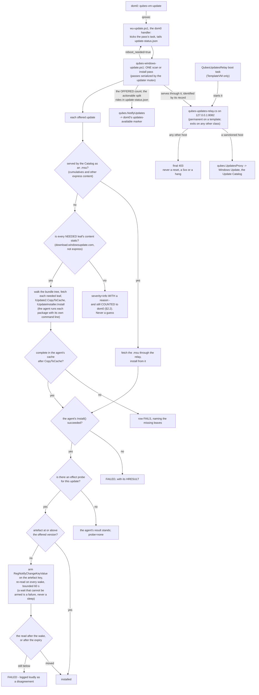

# ADR - the Windows updater (Track C)

## In plain English

dom0 drives Windows updates for a Windows qube exactly as for Linux templates. Automatic updates are off in the
guest, the qube reports what Windows offers, and dom0's own Qubes Update tool starts every install. The guest has
no route of its own: the updater fetches every file itself through a relay to dom0's update proxy. The relay runs
permanently on a template and nowhere else. Windows' peer-to-peer and background downloaders are never used.

One invariant governs the rest: what dom0 is told must be true. dom0 hears how many updates Windows is offering.
An update we cannot place still counts. There are two exceptions: an offer the pass verified has no route on this
guest at all, and Defender's definition updates, which never count. An install counts only when its effect is
measured, because an exit code of zero is not success. Our code never runs a vendor installer and never chooses
its switches. The guest requests restarts, dom0 performs them, and both are counted. Nothing is killed or
adopted by name, and data from outside never becomes a command.

A qube that updates itself, a StandaloneVM with its own internet, keeps Windows Update on, but Windows is set
never to restart it by itself, and a policy that overrides this is detected and reported. That is built; one
measurement is still owed.

dom0 needs no changes. Its stock updater drives a Windows qube through the same protocol as a Linux qube's update
agent - progress, messages and exit codes in that agent's format, written so that dom0 can parse them whatever the
guest's language - and a request to only download runs a pass that cannot install. The two settings a Windows
qube needs from dom0 are documented for the admin to apply; dom0's package applies and runs nothing.

The whole path, in one picture (§1, §2, §4, §5, §12):

## The decisions at a glance

| § | decision | status | date |
|---|---|---|---|
| 1 | dom0 owns updates; the guest never installs on its own | ACCEPTED | - |
| 2 | The invariant: dom0's reported state must be true | ACCEPTED; points 1, 5, 6 amended | 2026-11-14 |
| 3 | Verify by effect, never by exit code | ACCEPTED | - |
| 4 | Sanctioned paths hard-fail; never a timeout instead of an answer | ACCEPTED | - |
| 5 | Routeless by construction | ACCEPTED | - |
| 6 | Structured data only; no title parsing | ACCEPTED | - |
| 7 | A field report is reproduced on the reporter's measured environment | ACCEPTED | - |
| 8 | Reboots are counted: performed must equal requested | ACCEPTED | - |
| 9 | The test is the product | ACCEPTED | - |
| 10 | The guest cannot restart itself; a restart is REQUESTED, never taken | ACCEPTED | - |
| 11 | A cause outside our code, with a measured remedy, is CLOSED BY DECISION | ACCEPTED; applied once (`0x8024402C`), reopened 2026-11-14 | - |
| 12 | Architecture: who does what, and who may touch which process | ACCEPTED (owner, Jev); shipped in 4.3.33; 12.5 a record | 2026-10-03 |
| 13 | The installer waits for a running scan; a refused updater deploy is never quiet | ACCEPTED (Jev); shipped in 4.3.35 | 2026-10-04 |
| 14 | The cumulative goes first, and Windows is asked whether it registered it | ACCEPTED (Jev) | 2026-10-04 |
| 15 | Outside data never becomes a command | ACCEPTED | 2026-10-07 |
| 16 | The updater is graded in two phases: deterministic gates first, the dom0-driven sequence second | ACCEPTED (owner) | 2026-10-22 |
| 17 | Windows never restarts a guest on its own; a restart waits for the user, and a policy that overrides this is detected and warned about | ACCEPTED (owner, Jev 0.89); built, decision 1's measurement owed | 2026-11-13 |
| 18 | On a template the updates proxy stays up, gated by process, not by time; in an AppVM it is gone; command-line winget is served by identity, to any host | ACCEPTED (owner); points 1, 2, 4, 6 built; 7 written, its guest test owed; 3 not built | 2026-11-21 |

Status words and the section format are defined in `docs/ADR-README.md`. Each section below states the essentials.
`docs/REFERENCE-updater.md` keeps every section in full under the same number: the complete wording, context,
reasons, measurements, Jev verdicts and history.

---

## The decisions in detail

| record | content |
|---|---|
| `docs/REFERENCE-updater.md` | every section of this file in full, and the qrexec protocol in detail |
| `findings/updates.md` | standing facts about the update path, and retracted approaches |
| `findings/issues.md` | the open issue register (P1/P2/P3), maintained in place |
| `findings/rig.md` | rig and harness behaviour, including instrument traps |
| `findings/install.md` | getting a build onto a guest |
| `guest/qubes-windows-update.ps1`, `guest/qubes-updates-relay.cs`, `guest/wu-update.ps1`, `guest/install-updater-agent.ps1` | the components (§12.1) |
| `tools/wu-pass-judge.py`, `tools/wu-log-judge.py`, `mgmt/harness/wu-e2e.sh` | the judges and the end-to-end harness (§9) |

## 1. dom0 owns updates; the guest never installs on its own

**Status:** ACCEPTED.

**Decision.** Guest auto-update is off (`NoAutoUpdate=1`). dom0 drives every install. The guest reports
availability to dom0 over `qubes.NotifyUpdates`. A guest with no netvm reaches Windows Update only through
`qubes.UpdatesProxy`, through the template's relay, which serves update processes and winget only (§18).

**Why.** This is the Qubes model: the admin decides when a template changes, and a template with no netvm
cannot be left to update itself.

## 2. The invariant: dom0's reported state must be true

**Status:** ACCEPTED. Amended 2026-10-07 (point 1); 2026-11-01 (point 5, PROPOSED to the owner, who asked for
it); 2026-11-06 (point 5, offers with no KB, owner); 2026-11-14 (point 6, the owner's decision of 2026-10-16).

**Decision.** dom0 must never be told that a template is up to date when it is not.

1. dom0 is told the OFFERED count. The actionable split rides in `update-status.json` (`offered`,
   `actionable`), with a reason per item.
2. An update this path cannot install, or failed to install, is `severity=info` with a reason and is still
   COUNTED. A classification may narrow what a pass acts on, never the count.
3. An offer whose own identity (`UpdateID`, `RevisionNumber`) a pass installed and proved installed is gone and
   does not count. Besides points 5 and 6, only this may lower the number.
4. The invariant breaks both ways: too little (silence about a pending update) and too much (a count that can
   never clear). They are one defect class; fixing one direction does not close the other, and the open
   direction is never re-filed at a lower priority to call the work done.
5. One exception, MEASURED on every pass and never remembered: an offer this pass verified that no route of this
   guest can install leaves dom0's number. Verified means all three: the Update Catalog answered and has no
   package for this KB - for an offer with no KB, for its exact title - on this build and architecture; the
   content is not self-contained; and the guest has no default route for Windows Update's own downloader. An
   unresolved Catalog answer, or an offer with neither a KB nor a title, stays counted. Nothing keys on a build,
   a date, a class, a KB list or a switch. The owner, 2026-11-01: the decision is "we detected that we cannot
   install this update now, so we legitimately verified the reason and skipped it", not "we blacklisted ESU by
   class".
6. DEFENDER DEFINITION UPDATES DO NOT COUNT. The owner, 2026-10-16: «can we make a knob to exclude defender
   update notifications from reaching dom0? so defender will keep updating on schedule, just not raising this
   flag every few hours». A definition is an offer carrying Windows Update's own "Definition Updates"
   classification - never decided by a title, never by a KB number (owner, 2026-11-14: «i do not like
   classification by kb number. it may be a subject to change.»). An offer whose classification cannot be read
   counts. Every number dom0 hears leaves definitions out, and dom0's summary line says so; they are still
   offered, recorded and installed by every install pass. The classification also covers the Defender and
   Windows Security platform updates, so they leave the number too.

Point 3's identity is stamped inside `Install-ViaWU` and selected with `-OnlyUids`; the fallback queue stays a KB
list (2026-11-08, Jev).

**Why.** dom0's reported state is the product. A count lowered by our own inability to install is the "too
little" direction: a field reporter saw "no updates available" while their Windows Update window listed one. For
the exception, the route is the fact and a class only a hint: an update Windows serves only as express content
and the Catalog lacks can never be placed here, while a cumulative of the "wrong" class installed from the
Catalog.

**Cost.** Only dom0 starts an install pass, so on a template or an AppVM definitions and the two platform updates
arrive with the next update dom0 runs for another reason, and a clear flag asks for none. Point 2 does not
override point 6.

## 3. Verify by effect, never by exit code

**Status:** ACCEPTED.

**Decision.**

1. If an installer's effect can be measured, `rc=0` without that effect is not success.
2. A probe that ran and measured no change is a NEGATIVE RESULT, not missing data: the install failed.
3. A probe measures the artefact the installer actually changes, and is proven on a known-good install before a
   negative from it is believed.
4. Where no probe exists the row says `probe=none`. It never implies verification.

**Why.** An installer that returns 0 and changes nothing is the exact shape of a silent failure, and it reaches
dom0 as "pending forever" or "nothing to do" - both break §2.

## 4. Sanctioned paths hard-fail; never a timeout instead of an answer

**Status:** ACCEPTED.

**Decision.** The relay serves a sanctioned host, or refuses with a final 403. Never a reset, a 5xx, or a hang.

**Why.** A transient answer sends Windows Update into its "network is not connected" wait, which parks a
synchronous search until something kills the pass. A refusal is an answer; a timeout is not.

## 5. Routeless by construction

**Status:** ACCEPTED.

**Context.** A guest with no netvm has no default route, so Delivery Optimization and BITS cannot work. The guest
is offline by design, and that is not going to change.

**Decision.** The updater fetches content itself through the proxy: a catalog `.msu`, or a self-contained static
URL. A path that needs DO/BITS is classified, not retried.

**Cost.** Some offers are structurally uninstallable here and must be classified under §2.

## 6. Structured data only; no title parsing

**Status:** ACCEPTED.

**Decision.** Match rows by key, KB content by filename family, and an offer by its identity (`UpdateID` +
`RevisionNumber`). Never on displayed title text. A version number inside a title is the one exception, because
digits are language-free.

**Why.** The catalog's response language is not deterministic, and the reporter's environment is German. Any
logic keyed on a title is a defect waiting for a locale to expose it.

## 7. A field report is reproduced on the reporter's measured environment

**Status:** ACCEPTED.

**Decision.** The reporter's environment is data: `mgmt/reporters/<name>.json`. `mgmt/harness/env-assert.sh`
measures a guest against it and exits non-zero on any mismatch, and on any fact it could not measure. If the
environment does not exist on the rig, building it is the first task.

## 8. Reboots are counted: performed must equal requested

**Status:** ACCEPTED.

**Decision.**

1. No speculative reboots. Every power cycle traces to a request: the guest powered itself off, or
   `update-status.json` said `reboot_needed=true`.
2. A reboot counts as PERFORMED only when the guest has gone down and come back with qrexec answering.
3. If `reboot_needed` cannot be read it is UNKNOWN, and missing data fails. It is never read as false.
4. The harness fails the run on a mismatch in either direction: an extra cycle nobody asked for, or a requested
   cycle skipped.
5. A cumulative costs more than one cycle, and the extra one is CORRECT. Where the work can be ordered so one
   cycle serves, it is (§14). Where it cannot, Windows' own servicing completion takes a restart we never issue,
   ahead of our boot scan; no documented policy reaches it, and we do not race it. That cycle is accounted by the
   STANDING ANNOUNCEMENT: the pass reports the count still pending. The owner, 2026-11-08: «we collapse reboots
   when we can, if we can not, it is the right way to do until new api would allow a guest to self-announce a
   reboot». No new channel and no dom0 service are built; the count is the channel. Normal dom0 reads only
   `updates-available`, so in the field the announcement makes the remaining work visible and the admin acts on
   it; only our harness also accounts the cycle by it, and takes no change-nothing measurement while the guest
   reports itself unfinished. Settled until an API lets a guest announce a reboot; not to be re-argued.

**Why.** Rebooting until things settle is unfalsifiable, conceals the defect that needed the extra cycle, and
stops reproducing what a user gets, because a user reboots when Windows asks.

**Cost.** A qube that Windows' completion restart halted stays Halted until the admin starts it. Accepted, not
hidden.

## 9. The test is the product

**Status:** ACCEPTED.

**Context.** Every wrong verdict in this track came from an instrument, not from the code under test. The known
instrument traps are kept in `findings/rig.md` and `findings/updates.md`, because they change.

**Decision.**

1. Passes are judged by code, not read by eye: `tools/wu-pass-judge.py` (did the pass tell dom0 the truth) and
   `tools/wu-log-judge.py` (did the search enter the transient wait). `mgmt/harness/wu-e2e.sh` drives repeated
   passes through dom0's own `qubes-vm-update` sequence and judges every one.
2. Before grading, the installed file is proven to be the package's (byte count and guard markers). An
   installer's own success message is not evidence.
3. A wait keys on a property that DISTINGUISHES the new artefact from the old one.
4. An excluded item stays open until judged on its own, against evidence measured outside the updater; the
   updater's own reason is not evidence for itself. `wu-e2e.sh` exits **0** when every round passed and every
   exclusion is judged, **3** when a round failed, **4** when exclusions are unjudged.
5. Missing data fails, and every gate here has been seen to FAIL with its defect put back.

A harness rule for point 4 (2026-11-10, not an owner decision): an offer with no KB that the updater lists as
unroutable in every round that excluded it is judged by code. §2 point 5's three facts are each measured outside
the updater - the Catalog's answer for the exact title (from the development qube, with a positive control), the
offer's content as the agent itself holds it (read offline), and the netvm (from the Admin API). All three agree:
pass. One contradicts: a product FAIL. One unmeasured: INSTRUMENT. Jev is still asked and printed, and cannot
change the result. A round whose own content read is empty may take the other excluding rounds' reads of the same
identity, only when every one shows that UpdateID at the same RevisionNumber with no content, and the evidence
names the substitution (2026-11-12). Neither rule is a Jev verdict.

**Open.** An unroutable offer that HAS a KB (the Windows 10 ESU case) has no host-side Catalog measurement by KB
and is judged as before. The contradiction legs have run only on fixtures from one real capture.

## 10. The guest cannot restart itself; a restart is REQUESTED, never taken

**Status:** ACCEPTED.

**Context.** A Qubes HVM is `on_reboot=destroy` / `on_poweroff=destroy`: a guest-initiated restart leaves the
qube Halted, and only dom0 can start it again.

**Decision.**

1. A state the guest cannot leave on its own is REPORTED as a request (`reboot_needed=true`) with a message
   naming the action, and the pass stops there - never worked around by powering off, never hidden by retrying.
2. The guest powers itself off only where an admin-driven install or update pass asked for it (§8).
3. A guard that cannot measure what it needs says so and lets the pass proceed. An unmeasured guard is announced,
   never assumed in either direction.

**Why.** A guest that halts itself to fix its own problem takes the machine away from the admin without being
asked, and §8's accounting cannot tell that cycle from a requested one.

## 11. A cause outside our code, with a measured remedy, is CLOSED BY DECISION

**Status:** ACCEPTED. Applied once, below; reopened 2026-11-14.

**Decision.** We chase a cause until it is NAMED, or BOUNDED to a component that is not ours **and** a remedy is
measured. In the second case we stop deliberately, and the stop is recorded here rather than in the issue
register.

1. A stop states what is ESTABLISHED, what is NOT, the REMEDY that makes the residue tolerable, and what would
   REOPEN it.
2. A parked item does not stay in `findings/issues.md` as open work.
3. The remedy is in the product and FAILS LOUDLY if it stops working. A parked cause with no remedy is ignored,
   not parked.

### Applied: Windows Update's own proxy selection (`0x8024402C` on a routeless guest)

**Established.** On a guest whose updater was installed and which has not restarted since, Windows Update's
request omits the proxy configuration, resolves the hostname itself and fails with `0x8024402C`. Traced both ways
on one guest and reproduced on a second; everything outside Windows Update was excluded by measurement.

**Not established.** Why Windows Update omits the proxy early and attaches it later. No fixed delay may be
claimed.

**Remedy** (`GUARD:proxystateremedy`). The pass reports the reason it measured in that same pass and requests the
restart measured to clear the state, once per boot, through `reboot_needed` (§8, §10). dom0 is told no
availability number either way.

**Reopens if** the state survives a restart on any guest, the once-per-boot guard fires twice in the field, or a
Windows change makes the state persist. Reporting it outside this project is the other live option.

**Reopened, 2026-11-14.** On the field reporter's 4.3.43 guest the state survived a full restart twice:
findings/issues.md WU8024402CSURVIVESARESTART, docs/GWECK-STATUS.md row 47.

## 12. Architecture: who does what, and who may touch which process

**Status:** ACCEPTED (owner, Jev), 2026-10-03, after the KB5007651 failure; implemented in QWT-NG 4.3.33. Before
it, the updater ran installer-type packages itself with `/q`, and adopted and killed relays by name.

### 12.1 Components

| component | file | role |
|---|---|---|
| the pass | `guest/qubes-windows-update.ps1` | one scan or install pass; passes are serialized by the updater mutex (a second one refuses, `QWTUPDMUTEXHELD`) |
| the relay | `guest/qubes-updates-relay.cs` | the pass's only way out: `127.0.0.1:8082` -> `qubes.UpdatesProxy`; serves sanctioned hosts, refuses others with a final 403 (§4) |
| the dom0 handler | `guest/wu-update.ps1` | dom0's `qubes-vm-update` entry point: kicks the pass's task, tails `update-status.json`, cleans up after a pass that was killed |
| the scheduled tasks | `QubesWindowsUpdateScan` / `...Run` | the boot-time and periodic scan; the install pass dom0 asks for |
| the installer | `guest/install-updater-agent.ps1` | installs or upgrades the above (compiles the relay in place) |

### 12.2 Install routes

**Decision.**

1. **Search** is always the Windows Update agent's own online search, through the relay.
2. **What the Update Catalog serves as an `.msu`** (cumulatives and other express-content updates) is fetched by
   us and installed from the `.msu`.
3. **Every other offered update whose NEEDED content is static** is installed by the **Windows Update agent's own
   installer**: we fetch each needed leaf's files through the relay, hand them to the agent with
   `IUpdate2.CopyToCache`, and call `IUpdateInstaller.Install`. The agent runs each package with **the update's
   own command line**.
4. **Anything else** gets a row that says why: FAILED, or informational under §2. It never gets a guess.

- **No code of ours runs a vendor installer, and no code of ours chooses an installer's switches.** No switch
  table, no per-package special case.
- **The agent's downloader is never called on this path** (§5).
- If the update is not complete in the agent's cache after `CopyToCache`, the row FAILS and names the missing
  leaves.
- **A vendor payload is never carved, repacked, extracted or provisioned by us.**
- **The size dom0 shows is a measured number or no number - never the offer's `MaxDownloadSize`** (2026-11-01,
  Jev; PROPOSED to the owner, as it widens this section): the needed leaves' sum, or no size until the fetch
  measures the content.

**Why.** The switches are not ours to know. Where we guessed them we were wrong twice: `/q` made the Security
platform installer exit 0 and do nothing, and the Defender delta we ran ourselves failed while the agent applies
it through Microsoft's own stub. The update's metadata is the authority and the agent is the only component that
reads it, so the agent runs the package and we only supply the bytes it cannot fetch.

### 12.3 Verdicts

**Decision.** A row's result is the agent's per-update result AND our effect probe where one exists (§3).

| agent result | probe | row |
|---|---|---|
| succeeded | artefact moved to the offered version or above | installed |
| failed | - | FAILED, with its HRESULT |
| succeeded | artefact stayed below the offered version | FAILED, logged loudly as a disagreement |
| succeeded | none exists | the agent's result stands, `probe=none` recorded (§3) |

- The probe measures what the update changes - for the Windows Security platform, the platform's own
  registration, never the Security app. **ALREADY CURRENT** means the measured artefact is at or above the
  offered version; nothing else qualifies.
- **The effect is waited for, never assumed** (2026-10-03), only for a row the verdict would otherwise fail as a
  disagreement: a registry change notification on the artefact's key, a re-read on every wake, bounded 60 s
  after the agent returned. The read after the expiry decides, and a wait that cannot be armed is an ERROR.
- **A reboot left pending is reported at most ONCE.** The owner, 2026-10-03: "It is ok if we show that updates
  are still pending and reboot is required to dom0 once, we just want to avoid doing that more than once." A
  second such report for the same update cycle is a defect.

**Why.** The agent's result says the package ran; the probe says the thing dom0 is told about changed. Either
alone has read as success on a failed install, and the agent can return before the package's work is done.

### 12.4 Process ownership

**Context.** On 2026-10-03 the boot scan adopted a relay another process had started, and its cleanup killed every
process with that name mid-transfer. A process found by name is any process with that name.

**Decision.**

1. **A component touches only processes it started, and holds them by handle** (pid + start time).
2. **Nothing is ever killed or adopted by process name.**
3. **On a TemplateVM the relay is permanent, and no pass owns it** (§18). Its own boot task, `QubesUpdatesRelay`,
   starts it. Once it listens it records itself under `HKLM\SOFTWARE\Qubes\UpdatesProxy`: `Relay` = its pid and
   start time, `RelayLog` = its log file. A pass serves through it only when the owner of `127.0.0.1:8082` matches
   that record. If the port is free, the pass starts the task, logs it as an anomaly, and checks again. Any other
   holder of the port is refused with a named reason. A pass never stops the relay.
4. **The relay starts only on a TemplateVM, whoever starts it.** Before it listens it reads the class from
   QubesDB, does not listen while QubesDB cannot answer, and exits on any other class.
5. **The handler's dead-pass cleanup kills nothing.** The recorded relay is not a dead pass's leftover. Any other
   listener on the port is reported as an anomaly.
6. **The installer kills nothing by name or port.** It ends the relay through its task, replaces the exe, and
   starts the task again. Any other listener: it waits for it to exit, or keeps the previous relay exe and says why.
7. A commit-time lint refuses kill-by-name and adopt-by-name in shipped guest scripts.
8. **A relay that stops on its own is reported; a stop that was asked for is not** (owner 2026-11-26: «as relay gets
   permanent crash should be reported. do not confuse crash with intented shutdowns»). A crash (Application Error) or
   any non-zero task result is a death report. The installer's `schtasks /end`, the stop before msiexec, a system
   shutdown, and the exit off a template are not. The task has no time limit, so a Task Scheduler end of it is always
   a requested one.

### 12.5 Network channels: what each one needs to reach the relay

**Status:** RECORD, 2026-11-17, on the owner's order: what the shipped code does and what was measured on the rig
(the row-47 runs of 2026-11-17). Line numbers are `guest/qubes-windows-update.ps1` unless a file is named.

**The carrier.** Every channel leaves through the relay `127.0.0.1:8082` (on a template: started at boot by its own task, permanent, §12.4 point 3),
then qrexec `qubes.UpdatesProxy`, to whatever the target dom0's policy names. The relay filters by host suffix and
by process. Only a TemplateVM runs a pass.

| # | channel | carrier | how it reaches the relay | evidence |
|---|---|---|---|---|
| 1 | Search: SLS lookup (skipped once the guest is seeded) | Windows Update agent | The signed-in user's own proxy, or the per-machine policy present at sign-in (the pass writes the machine values after it). `netsh` alone does not carry it. | measured: run17c-e, run18 arm A, run19, run20 T; `netsh` alone: run18 arm 0, one run |
| 2 | Search: scan web service (fe2cr/fe3cr) | Windows Update agent | Logs `AllowUserProxyAsFallbackToSystemProxy`. `netsh` alone works; the user's own proxy alone works. | measured: run20 D; run19 |
| 3 | Search: device ticket (`AuthTicketHelper::GetDeviceTickets`) | Windows Update agent | Fails `800704CF` in every arm that searched; the search completes anyway. | measured: run19, run20 |
| 4 | Catalog lookup | the pass, `Invoke-WebRequest -Proxy` | Proxy named in the request. | code `:1597`, `:1663` |
| 5 | Catalog `.msu`: cumulatives, .NET (12.2 point 2) | the pass, `Fetch-Msu` (`:1803-1820`), installed from the `.msu` | Proxy named in the request. | code; the install has never run without the machine proxy |
| 6 | Static content: Defender definitions, MSRT, Security platform (12.2 point 3) | the pass fetches, `CopyToCache`, the agent's own installer | Proxy named in the request. | code `:2280-2330`; the install has never run without the machine proxy |
| 7 | Drivers with no KB | Catalog by title, the pass, `pnputil` | Proxy named in the request. | code `:1507-1526`, `:2151` |
| 8 | Certificate trust lists | the pass, to a local mirror (`RootDirURL`); CryptoAPI reads the mirror and itself goes direct | Proxy named in the request. | code `:885-937`; "goes direct" is the 2026-08-19 measurement in the code comment `:871-877` |
| 9 | Windows Update's own downloader (DO/BITS) | Windows Update agent | Not used without a route (`:3681-3683`). Used with a route (`:3237`, `:3477-3479`), with `QUBES_UPDATES_ALLOW_WU_NATIVE=1`, or with `-Action wuinstall` by hand. | code |
| 10 | Defender's own updater | Defender | Not a route of ours. The relay admits its processes and hosts (`relay.cs:167`, `:174`, `:490-491`). | not measured whether it uses a pass |

Only the search (rows 1-2) needs a Windows proxy setting; rows 4-8 name the proxy in each request. The shipped
code gives the search that setting machine-wide, at every pass (`Ensure-Proxy` `:821-856`); what that leaves in
the template and in every AppVM is tabled in the reference.

## 13. The installer waits for a running scan, and a refused updater deploy is never quiet

**Status:** ACCEPTED (Jev), 2026-10-04; shipped in 4.3.35.

**Context.** Field report (4.3.33, a German Windows 11 25H2 template): dom0 showed no updates while Windows Update
listed one. The installer's updater deploy ran inside the previous updater's boot scan, which held the updater
mutex; the deploy refused, the installer still reported success, and the guest kept its old updater.

**Decision.**

1. **A running SCAN is waited for, on the mutex itself**, once the installer has identified the holder as a scan
   (its recorded owner is alive, or the Scan task is running and wrote the record).
2. The wait is one kernel wait on the mutex, bounded by the scan task's own time limit less the time it already
   ran, plus PT3M. Expiry is a loud refusal (`QWTUPDSCANWAITEXPIRED`); there is no proceed-anyway branch.
3. **Nothing else is waited for.** Any other holder is refused at once (`QWTUPDMUTEXHELD`), naming the holder, the
   task states and the remedy.
4. Abandoned after a scan, the mutex is taken and the deploy proceeds; abandoned after anything else, it is given
   back and the deploy refused.
5. **A refused or failed deploy is an ERROR of the install**: the RESULT becomes `ok:false`, the log ends saying
   the Windows Update agent was NOT installed and what to do, and dom0 is notified once QrexecAgent runs.
6. **The deploy runs after the stage-2 qrexec release** (`docs/ADR-boot.md` §2 rule 8).
7. The remedy is the existing `install.cmd /updatesonly`. No boot-time retry is built.

**Why.** A scan is the one holder that installs nothing and ends on its own; refusing it made the ordinary
sequence - boot the template, run the installer - keep the previous updater.

**Cost.** An install that meets a running scan waits for it (measured 18 s and 28 s; bounded by the scan's limit
less its run time, plus PT3M). A scan that holds the mutex before its first record write is refused, loudly,
instead of waited for.

**Evidence.** Seen to fail: 4.3.34 on the reporter's environment (2026-10-04). Seen to pass: the 4.3.35 release
candidate, on two witnesses (2026-10-06).

**Open.** The dom0 notification of a refused deploy is not measured arriving in dom0; a scan reaching its limit
during the wait is tested offline only.

## 14. The cumulative goes first, and Windows is asked whether it registered it

**Status:** ACCEPTED (Jev), 2026-10-04.

**Decision.**

- **Only the `.msu` route is reordered.** The catalog `.msu` are installed after the offer loop - the cumulative
  first, then the others in offer order. Everything else still installs inline.
- **Which package is the cumulative is DISM's answer** (`OnePackage` or `RollupFix`), never the title and never
  the filename (§6).
- **The cumulative is installed only while nothing is pending.** CBS `RebootPending` set: the cumulative is
  DEFERRED with that reason and the restart requested (§8, §10). Unreadable: it proceeds, and the pass says so.
- **One relaxation of one package per pass:** a package that is not a cumulative may stage behind a cumulative
  this pass staged AND Windows registered. A second cumulative is deferred.
- **For the cumulative, DISM's 3010 is not the answer; the package list is.** A `RollupFix` package must be NEWLY
  `InstallPending`, read as structured data; otherwise the KB FAILS, saying Windows did not register it. An
  unreadable list is the same failure with "unknown": nothing unverified is ever reported as staged.

**Why.** On the reporter's German 25H2 template, DISM returned 3010 for a cumulative Windows never registered, so
3010 alone would have reported it staged - the concealing direction of §2. The cumulative first and .NET second
landed both at one restart. That mechanism is inferred, so the design does not rest on it: a miss of the order
ends in a truthful deferral or a failed row that requests the restart.

**Cost.** The cost is at most one extra restart, and dom0 is told once that work is pending and a restart is
required - the owner's rule - never that something will complete when it will not.

**Evidence.** Replayed offline by `tools/tests/wu-cumulative-order-test.ps1`.

## 15. Outside data never becomes a command

**Status:** ACCEPTED.

**Decision.** Data the updater did not author - a host some process on the guest asked for, a file name from the
Update Catalog, arguments from dom0 - becomes decisions and arguments, never a command line that something else
parses.

1. **No shell, anywhere on this path.** Native tools are called with an argument array; nothing builds a string
   for `cmd /c`.
2. **A requested host decides a verdict; it never reaches an argument.** The relay's qrexec call carries a target,
   the service, a user, our own path, a port we bound and a token we minted - never the host. Two surfaces are
   ours, not guarantees: `QUBES_UPDATES_TARGET` selects the target when `--target` is absent (the shipped path
   always passes it, and dom0's policy is the boundary), and no field may contain a `|` (nothing checks it; it
   holds by our install path).
3. **A catalog file name is a path in our own working directory**, passed as one quoted argument.
4. **dom0's arguments narrow, they do not compose**, and never narrow what dom0 is told (§2.2).
5. **Where a native tool's own parser forces a shape** (`qrexec-client-vm.exe` splitting on `|`, `sc.exe`
   rejecting an empty argument), the shape is documented at the call site AND asserted by a test.
6. **The verdict on such a call is the effect, not the exit code** (§3).

**Why.** Our code never runs a vendor installer (§12), which removes the largest surface by construction. For the
handful of native tools we do call, outside data is an argument or a decision, never syntax.

## 16. The updater is graded in TWO PHASES: deterministic gates first, the dom0-driven sequence second

**Status:** ACCEPTED (owner), 2026-10-22.

**Decision.** Quick, deterministic, self-contained gates run FIRST; the full dom0-driven sequence runs only if they
pass. The owner: *"BEFORE the full sequence starts, we want quick check if main functionality passes without
failure."*

- The gates have ONE implementation, `mgmt/harness/updater-gates-lib.sh`: standalone in
  `mgmt/harness/updater-component-test.sh`, and as the preflight of `mgmt/harness/template-update-test.sh`.
- U1-U7: the deploy vouched and compiled the relay; the placed exe is the shipped binary; the relay listens on
  8082 for its pass; the pass used a relay it started and adopted nothing; a count reached dom0; no pass died on
  "not accepting connections"; the subject is the reporter's recorded environment.
- The base is GWeck's sealed German 25H2 TemplateVM, and every gate reads our own log lines or a number, never a
  Windows string.
- Installing, reboot accounting, oscillation and the exclusion audit stay with the old gate. The component gate
  scans only, and reports: it cannot abort a campaign.
- **Jev is a secondary evaluator.** The deterministic gates decide; on a failure Jev's ranking of the candidate
  causes is printed and cannot change the verdict. The owner: *"the main flow should stay determenistic and self
  contained, but we SHOULD ask jev for supplementary data."*
- **Diagnosis is by discriminator**: each candidate cause is tied to a string the product emits on exactly that
  path, and reported CONFIRMED, EXCLUDED or POSSIBLE.

**Why.** The old gate asserted nothing about the relay, so a broken relay compile reached it as an update-outcome
symptom and was blamed on four wrong causes in turn, each costing about an hour of the operator's dom0. Two
minutes of gates in front of it name the fault the first time.

**Evidence.** `tools/tests/updater-component-selftest.sh` drove the seven gates against the real captures of
2026-10-22: the post-fix pair passed, the pre-fix pair failed, and each gate failed alone without its own evidence.
It was deleted 2026-11-26: those captures are of the pass-owned relay, and U3 and U4 now require the template's
permanent relay (§12.4 point 3).

## 17. Windows never restarts a guest on its own; a restart waits for the user, and a policy that overrides this is detected and warned about

**Status:** ACCEPTED (owner, 2026-11-13; Jev accept 0.89); built in `guest/qubes-windows-update.ps1`, in builds
since 4.3.43. Decision 2 is measured on a guest; decision 1's measurement is still owed.

**Context.** A StandaloneVM with direct internet updates itself, and Windows Update may then restart it; the qube
is `on_reboot=destroy` (§10), so it is left Halted. Windows documents `AUOptions=4` with
`NoAutoRebootWithLoggedOnUsers=1`: updates stay on and the restart waits for a signed-in user.

**Decision.** The owner: *"no auto reboots whatsoever. if group policy overrides this, it is different story"*,
*"so if it does, we detect and warn"*, and *"on standaloneVM updates stay on, but no automatic reboots. on
templateVM and appVM they are off"*. Notify-only (`AUOptions=2`) was declined the same day: *"we always have
someone signed in, and user-started installs are fine, so keep the old setting"*.

1. Windows Update may stay on, set never to restart the guest by itself. The updater writes the two values where
   it turns updates on, before it removes `NoAutoUpdate`, and nowhere else. When they cannot be written,
   `NoAutoUpdate` stays.
2. A policy that makes an automatic restart possible after all is detected by the pass, on every class, and
   warned about loudly through the ONE reporter (ADR-supervision §3). A restart counts as possible where updates
   can install by themselves and either the two values are not both in force or a deadline policy is set; Group
   Policy and device management each count on their own.
3. Managed guests (domain or device-management policy) are future work; until then they are detected and warned
   about, nothing more.

Where points 1 and 2 act, and the per-source rule, were chosen without a Jev verdict (under floor).

**Cost.** An update that needs a restart stays pending until the user restarts, however long that takes.

**Evidence.** Decision 2, measured 2026-11-13 with 4.3.43: as installed the pass logged `WUAUTORESTART none`; with
device management `AllowAutoUpdate=2` it logged `possible` at ERROR and dom0 acknowledged one notice; with the
value removed, `none` again. Decision 1 is owed: a StandaloneVM clone installs a cumulative with the autologon
user signed in, against a control without the values. The code shipped in 4.3.43 without it.

**Open.** TrustedInstaller's servicing-completion restart (§8 point 5) is reached by no documented policy. A guest
at its logon screen has no signed-in user, so the setting does not hold there. A guest installed with
`/noupdates` gets neither the values nor the warning.

## 18. On a template the updates proxy stays up, gated by process, not by time; in an AppVM it is gone

**Status:** ACCEPTED (owner, 2026-11-18; points 6 and 7 owner, 2026-11-21). Points 1, 2, 4, 6 and 7 are built. Point 3 needs a
relay that serves between passes, which is not built; until it is, nothing listens on 127.0.0.1:8082 between passes.

**Context.** Row 47 (`0x8024402C`): Windows Update takes its proxy from the per-machine policy present at sign-in
or from the signed-in user, never from what a pass writes mid-session (§12.5 row 1). A proxy that exists only while
a pass runs therefore misses the lookup. A per-search window in the signed-in user's settings was measured and
declined the same day.

**Decision.** The owner: *"we do not want to disable proxy globally. we want to keep the process gate, but having
manual updates and installs work would be a nice addition. so no time window, just make sure it is gone in appvm"*,
*"and that it is not accessible by non-update process (test it)"*, and *"we keep our paths because it makes update
process more tidy, but that would be it."*

1. On a TemplateVM the updates proxy stays configured between passes. There is no temporal gate and no time window.
2. The process gate is the only gate: a process that is not an update process is refused by the relay. This is
   shown by a test on a guest in which a non-update process is refused, before the change ships.
3. Windows Update and installs the user starts on the template working through it is a welcome addition, not a
   requirement.
4. In every class that is not a TemplateVM, the proxy configuration is gone.
5. Our own update paths (§12.2) stay because they make the update process tidier. That is the only reason for them.
6. Defender's cloud hosts, `wdcp.microsoft.com` and `wdcpalt.microsoft.com`, are in the template's WinHTTP and machine
   WinINET bypass lists. With nothing listening on the port, Smart App Control's lookup for a never-run binary held its
   start ~8 s (65-75 ms bypassed). Asked to choose between this bypass and a relay that listens between passes, the
   owner chose *"Both"*: the bypass in this cut, the standing relay after it.
7. Command-line winget on a template goes through the relay, identified by binary and path, and may reach any host.
   The owner, 2026-11-21: *"we want the command line winget to run. can we identify it by binary and path, not by
   executable name?"* and *"yes lets allow any host"*. A peer is winget when its real image path is
   `%ProgramFiles%\WindowsApps\Microsoft.DesktopAppInstaller_<version>_<arch>__8wekyb3d8bbwe\winget.exe` (only the AppX
   deployment service writes there, and it names the folder after the signer's publisher id) and its package family,
   read from the process, is `Microsoft.DesktopAppInstaller_8wekyb3d8bbwe`. Path alone admits nothing a user can
   place; identity alone is forgeable with `Invoke-CommandInDesktopPackage`. No LocalSystem rule applies to it, and
   only it skips the host allowlist; Windows Update, Delivery Optimization and BITS keep that allowlist, since any user
   can drive them. Built in `PeerIsWinget` and `IsWingetImagePath` (the relay). Point 2's test on a template guest: a
   renamed curl, curl under `Invoke-CommandInDesktopPackage` and a user's powershell are refused, and winget's own
   search is served, which needs the package-identity call to answer. Until point 3's standing relay exists, winget is served only while a pass runs.
   Two machine policies are part of the template's proxy configuration (point 1) and go with it (point 4). WinINet's
   server-certificate revocation check is off (`CertificateRevocation` 0 under the Internet Settings policy key): with no
   network adapter Windows fetches no revocation data, and a package's integrity is the manifest SHA-256 winget verifies.
   The owner, 2026-11-21: *"turn ocsp off if it troubles you"* and *"the packages are signed so who cares about
   certificates"*. winget's `DefaultProxy` policy names the relay, so winget downloads through WinINet, not Delivery
   Optimization, which reaches nothing on a template. Outside a template the revocation value is removed whoever wrote it.
   Templates only:
   the owner, 2026-11-21, *"it should NOT exist on anything but templates. everything else takes direct path or fails"*.
   The pass already exits before any proxy activity outside a TemplateVM (`qubes-windows-update.ps1`, the class branch
   after `Get-QubesVmClass`), and point 4 removes the configuration there; the relay must carry the same check
   itself and exit outside a TemplateVM, whoever starts it (§12.4 point 4). On an AppVM or StandaloneVM, winget goes
   direct through the netvm or fails.

**Supersedes** the temporal gate: "the proxy is torn down when the pass ends" (`guest/qubes-updates-relay.cs:172-173`,
owner 2026-08-21), "up only during it" in §12.5, and §12.4's "the pass owns exactly one relay, the one it started"
and "a relay lives only as long as its pass" (`--parent-pid`), corrected 2026-11-26 (owner: «the relay time-framing
is stale record that outlived the decision to make it permanent»).

**Open.** Which processes count as update processes, and how the gate tells them apart from a process that only
carries the same name.

## 19. Only a pass dom0 started may complain to dom0

**Status:** ACCEPTED (owner, 2026-11-19).

**Context.** The scheduled scan runs on every qube with the updater, whether or not that qube can be updated: an
offline StandaloneVM, a template without a working updates path, a stripped image. Its failure reached dom0 as
"The Windows Update scan task failed", from the task-death reporter, about an update nobody asked for.

**Decision.** The owner: *"updater should fail loud to dom0 only if update was initiated by dom0. otherwise qube may be
genuinely non-updateable and no dom0 bubbles should complain about the fact."*

1. A failure of a pass dom0 started (QubesWindowsUpdateRun and QubesWindowsUpdateDownload, which only dom0's
   `qubes-vm-update` starts, through `vmupdate-shim.ps1` and `wu-update.ps1`) is loud: dom0's call gets the error,
   and the death reporter notifies.
2. A failure of a pass the qube started itself (QubesWindowsUpdateScan, started only by its boot and interval
   triggers) is written to the guest's logs and the status file, and nothing goes to dom0 as a notification.
3. Who started a pass is read from which task ran it, never from a clock or a guess.

4. The §17 warning that a policy lets Windows restart the qube by itself is not a failure and is not covered by point 2:
   the scheduled scan keeps sending it. The owner, asked the same day: *"no, it is genuinely useful warning."*
