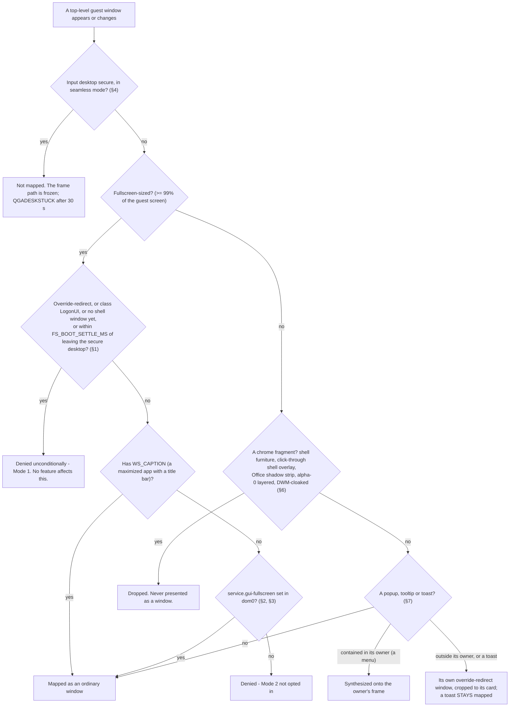

# ADR - windows: which guest surfaces become dom0 windows, and how the guest keeps a session

Index of the graphics decisions across all ADRs: `docs/ADR-graphics.md`. This file is the contract for its own decisions, in full.

## In plain English

Not every window a Windows guest has should become a window on your desktop. The agent decides, and these are
the rules.

Windows' own boot, sign-in, lock and shutdown screens are never shown, recognised by class and by phase, and
no setting changes that. A borderless window filling the whole guest screen (a game, a video) is shown only if
you opted in for that qube with a single dom0 feature; a maximized application with a title bar is always
fine. That feature is the only control, and the README's table is its specification. Windows' secure desktop
(UAC prompts, the lock screen) is never presented as free-standing windows in seamless mode, because each
would be indistinguishable from dom0's own interface. A UAC prompt is therefore configured to appear on the
normal desktop as an ordinary window, and while the secure desktop is up a seamless qube shows nothing new. In
the whole-desktop mode the secure desktop is shown inside the one bounded window, which the guest can never
grow to your screen size on its own.

Fragments of application chrome that are not windows (Office's shadow strips, shell overlays, the shell window
itself) are dropped rather than bordered. The fix for a mis-bordered fragment is always to stop presenting it,
never to weaken dom0's borders. Menus and tooltips are sent borderless, as the Linux agent does; toasts
likewise, and they stay shown. The Start menu is not presented in seamless mode. If the capture helper the
design relies on is missing or dead, the agent fails visibly, with a black window that stays mapped and an
error in dom0, rather than silently falling back to copying the whole desktop. A window that is only slow to
paint is not reported: you are told only when the helper is down or could not take the window. Everything the agent changes in
the guest for seamless mode (title bars stripped, Windows key blocked, shadows off) is applied in one place
and undone when the mode switches.

Finally, autologon is enforced, because a guest parked at the sign-in screen is unreachable: dom0 cannot run
anything in it, and in seamless mode it is invisible. The password is validated before anything is written and
stored only as a protected system secret, and a boot-time task re-asserts the arming. A qube made from a
template without the template's private volume, where every user profile lives, starts with no desktop; the
same task tells you so in dom0, with the command that makes a working copy. Repairing such a qube in place is
proposed, not built.

How the agent decides whether a guest window becomes a dom0 window (§1, §2, §4, §6, §7):

## The decisions at a glance

| § | decision | status | date |
|---|---|---|---|
| 1 | The boot, logon and shutdown screen is never shown to dom0 (Mode 1) | ACCEPTED (owner), unconditional | 2026-08-28 |
| 2 | A borderless true-fullscreen app window is shown only when dom0 opts in (Mode 2) | ACCEPTED (owner) | 2026-08-28 |
| 3 | ONE control: `service.gui-fullscreen`, and the README table is its specification | ACCEPTED (owner) | 2026-09-01 |
| 4 | The secure desktop is handled by mode; the safety criterion is geometry, not desktop identity | ACCEPTED (owner) | 2026-08-28 |
| 5 | The non-seamless desktop is one bounded window the guest can never grow to the host | ACCEPTED (owner) | 2026-08-27 |
| 6 | Chrome fragments are not windows; dom0's bordering is never weakened | ACCEPTED (owner) | 2026-08-26 |
| 7 | Popups, tooltips and toasts are override-redirect windows; a contained menu is synthesized onto its owner | ACCEPTED (owner) | 2026-08-16 |
| 8 | No composite fallback on a direct-capable guest: fail hard and visibly | ACCEPTED (owner) | 2026-09-06 |
| 9 | Seamless tweaks are applied in one place and reversed by construction | ACCEPTED (Jev 1.00) | 2026-09-25 |
| 10 | Autologon is enforced: a guest without a session is unreachable | ACCEPTED (owner) | 2026-08-28 |
| 11 | A hidden Start menu is CLOSED by returning activation, and the closure is recorded once | decided, unmeasured on a guest | 2026-10-17 |
| 12 | A withheld window is reported to the user only for a fault that waiting cannot resolve | ACCEPTED (owner, Jev) | 2026-11-14 |
| 13 | A guest whose profiles live on an empty private volume says so, with the remedy | ACCEPTED (Jev 0.75) | 2026-11-15 |
| 14 | Repairing such a guest: a fresh private volume, then power off | PROPOSED (Jev 0.75) | 2026-11-15 |

Status words and the section format are defined in `docs/ADR-README.md`.

---

## The decisions in detail

Where the details live:

| record | content |
|---|---|
| `CLAUDE.md`, "Product decisions (binding)" | the owner-approved spec for fullscreen, the secure desktop, autologon, window filtering |
| README, "Configuration" table | the specification of `service.gui-fullscreen` and the other features |
| `docs/QVM-FEATURES.md` | every feature, its default and precedence, generated from the source |
| `findings/windowing.md`, `findings/autologon.md` | the measurements behind each section |
| `docs/DESIGN-nonseamless-buildout.md` | the non-seamless desktop: what works, what is still owed (2026-09-25) |
| `guest/set-autologon.ps1`, `guest/ensure-autologon.ps1` | autologon as built; the header states the reasons |
| `agent/gui-agent/main.c` (`ShouldAcceptWindow`, `ProcessNewFrame`, `ApplySeamlessTweaks`) | where §1-§4, §6-§9 are enforced |

## 1. The boot, logon and shutdown screen is never shown to dom0 (Mode 1)

**Status:** ACCEPTED (owner), unconditional; not governed by any feature. Spec in `CLAUDE.md`; measured
2026-08-28 and 2026-09-01 (`findings/windowing.md`).

**Context.** Windows renders its login, lock, "shutting down" and initial-desktop screens through a single
full-screen `LogonUI` window. Mapping it produced a black or blue frame that took over the qube's window at
every boot and shutdown. Class-only matching once let a fullscreen boot surface through, so the rule matches
by PHASE as well.

**Decision.** In `ShouldAcceptWindow`, a fullscreen-sized window (>= 99% of the guest screen) is denied:

1. by class, when the class contains `LogonUI`;
2. by phase, while no shell window exists (boot, logon, shutdown), while the input desktop is secure, and for
   `FS_BOOT_SETTLE_MS` after it stops being secure;
3. unconditionally when it is override-redirect.

An already-announced window that becomes ineligible (it animates into borderless fullscreen with the feature
off) is unmapped at once in the tracking pass, not on the next remove, so there is no map-then-unmap flash. A
guest that reaches a *visible* sign-in screen is a misconfiguration to fix with autologon (§10), not something
the agent renders.

**Evidence.** Fault-injection bit `FI_GATE_MODE1` lets the acceptance see the gate fail on one binary. The
"fullscreen flash" history (window 0 at shutdown, Progman by class, gui-emulated, seamless-mode defaults) is
superseded: the flash was per-window LogonUI, and this clause is what removed it.

## 2. A borderless true-fullscreen app window is shown only when dom0 opts in (Mode 2)

**Status:** ACCEPTED (owner). Spec in `CLAUDE.md` and the README table.

**Decision.** A borderless window (no `WS_CAPTION`) of >= ~99% of the guest screen - a game, a video, a
presentation - is mapped only when dom0 opted in with `qvm-features <vm> service.gui-fullscreen 1`. qubesdb's
`/qubes-service/gui-fullscreen` wins over the guest registry `ShowFullscreenScreen`; both are read once at
agent Init. A maximized window WITH a title bar is always allowed. An override-redirect fullscreen window never
maps, feature or not (§1).

**Why.** A borderless window covering the whole screen is a guest surface indistinguishable from the host's
own display; whether a qube may paint that is dom0's choice, per qube, never the guest's.

**Evidence.** Fault-injection bit `FI_GATE_MODE2`; the acceptance's SG2/SG4 cells exercise the deny
discriminators and SG3 maps a windowed fullscreen 6/6. The feature-ON arms are owner-attended and still owed
(PASS-UNPROVEN per SG11, `docs/ACCEPTANCE-4.3.16.md`).

## 3. ONE control: `service.gui-fullscreen`, and the README table is its specification

**Status:** ACCEPTED (owner: "do not complicate the controls").

**Decision.** `service.gui-fullscreen` is the single control for guest-originated fullscreen. The top-level
README's feature table is its specification: when behaviour and README disagree, the README wins and the code
changes. No knobs, modes or behaviours are invented around it. Since 4.3.33 the feature governs ONLY Mode 2:
dom0's `qubes.SetGuiMode` (the whole desktop in one window, §5) is honoured on any guest, feature or not.

**History.** A split flag `service.gui-windowed-desktop` was written (agent 0fc00ca) and reverted in full
15 minutes later (6e6329a); it never shipped. The harness never sets `service.gui-fullscreen` on any guest and
never signals the mode-switch events: feature-ON arms and any windowed-desktop exercise are owner-attended.

## 4. The secure desktop is handled by mode; the safety criterion is geometry, not desktop identity

**Status:** ACCEPTED (owner, revised 2026-08-28; read this version, not the older "hide unconditionally").

**Context.** Pre-fix agents attached to the Winlogon desktop during an elevation and mapped BOTH the consent
dialog AND the fullscreen dimming backdrop into dom0; the backdrop IS the field-reported "unclosable black
window". Each secure surface mapped in seamless mode would be its own standalone dom0 window, indistinguishable
from dom0's own UI.

**Decision.**

| mode | the secure desktop |
|---|---|
| seamless | never mapped. `AttachToInputDesktop` tracks `g_OnSecureDesktop`, and the frame path, the event path and the init enumeration all return early while the input desktop is not Default. **CORRECTED 2026-10-08:** this row said "`ShouldAcceptWindow` rejects everything while it is set" - that was v1 (07fb32d), replaced the same day by the three early returns because the accept-filter deny unmapped every already-open window; see `ADR-uac` §4. A persistent freeze is logged `QGADESKSTUCK` after 30 s, then every 120 s. A pending UAC elevation is therefore INVISIBLE in seamless: the qube "does nothing" until the prompt is answered or times out, and the agent log says why (standing owner decision; UAC visibility is future work). |
| non-seamless | shown, secure or not: the sign-in screen or a prompt appears inside the one bounded desktop window (§5), which is what makes it safe. |

Two settings follow from it:

- **UAC prompts are drawn on the normal desktop** (`PromptOnSecureDesktop=0`, written by
  `ApplyUacPromptPolicy`), so a prompt is an ordinary bordered window in both modes. `ADR-uac.md` is the
  UAC-specific record - what may elevate at all (§10), the stand-in window (§6) and a prompt Windows did not
  raise (§7); this section stays the window-mapping rule. Where the prompt is drawn
  is deliberately not configurable. Protocol SG5 calls this load-bearing; the IDD boot-path measurement found
  it fixed nothing else (zero recorded UAC-desktop events).
- **`service.uac-disable` acts only on an explicit `1`**, needs a reboot, and must be set on the TEMPLATE
  (`EnableLUA` is latched inside LSA at boot; an AppVM's system drive is restored at every boot). A feature
  cleared the ordinary way reads back as `0`, so a plain on/off knob would let "clear the feature" silently
  disable UAC. It is the Windows equivalent of passwordless sudo and is framed as that, never as a security
  improvement.

**Evidence.** Reproduction needs `EnableLUA=1`; the rigs default to `EnableLUA=0`, which is why the black
window was never seen locally, and `win11-tpl` is deliberately kept at `EnableLUA=1` as the field-faithful rig.
Agent 07fb32d logs "secure-desktop ENTERED/LEFT ... mapping suppressed".

## 5. The non-seamless desktop is one bounded window the guest can never grow to the host

**Status:** ACCEPTED (owner, the hard geometry guard 2026-08-27; the live switch since 4.3.33). The owner's
rule: "never fucking ever non-seamless mode goes fullscreen unless requested explicitly".

**Decision.**

1. `qubes.SetGuiMode` is honoured on any guest. On entry the desktop surface is plugged in like a monitor: the
   whole-desktop grant is made and window 0 is mapped. On exit it is unplugged. A seamless guest therefore never
   holds a whole-desktop grant (`SeamlessNoScreenGrant`, on by default; on a guest with `service.gui-fullscreen`
   the agent turns it back off at start and says so, `P2NOGRANT not applied`).
2. Window 0 is shrunk on entry to the windowed default (1280x800) and is refused at host size unless the size
   came from dom0 (`g_ResolutionFromDom0`): a guest-originated host-sized window 0 is NEVER mapped; the agent
   shrinks and defers the switch (`g_NonSeamlessPending`). dom0-requested sizes are never second-guessed.
3. The agent echoes dom0's own window-0 position back (`g_ScreenWinX/Y`) so the daemon resizes in place and
   never repositions.
4. The published IDD mode set carries the host size only while seamless is active (`docs/ADR-display.md` §4),
   so a guest cannot select its way to fullscreen.
5. Inside the desktop, applications keep their own title bars (§9), and resizing the dom0 window resizes the
   guest's screen to match, including to arbitrary sizes.

**Evidence.** The switch executes in both directions and persists across a reboot; a first entry renders a
correct live desktop (5120x1384 verified by capture); resize and input are closed end to end
(`findings/windowing.md`, 2026-09-25). What was still owed on 2026-09-25 - the frame supply dying on later
entries (`QGACAPDEAD` now notices it; root cause open), and the entry at 96% of host height that the 99% guard
did not trip (Jev: violates the rule 0.60) - is tracked in `docs/DESIGN-nonseamless-buildout.md`, not here.

## 6. Chrome fragments are not windows; dom0's bordering is never weakened

**Status:** ACCEPTED (owner). Shipped predicate as of agent 8ee3390 (2026-08-26) and later.

**Context.** Post-2013 Office surrounds its frame with layered, click-through shadow HWNDs, and the agent
mapped each as a separate window, so dom0 drew a border around every fragment. The Win11 25H2 "double windows"
class and Progman mapped as a black fullscreen window (field post 85) are the same defect: a surface that is
not a window presented as one.

**Decision.** The filter lives in `ShouldAcceptWindow` and drops:

- the shell window itself (`GetShellWindow()` identity);
- shell furniture by ATTRIBUTE: `NOREDIRECTIONBITMAP + TOOLWINDOW + !TOPMOST` (attribute-based on purpose:
  `GetShellWindow()` is NULL at agent start on 25H2);
- click-through uncapturable shell overlays: `TRANSPARENT + NOREDIRECTIONBITMAP + TOOLWINDOW` (Win11 snap/drag
  XAML overlays);
- Office shadow strips by STYLE (`LAYERED + TRANSPARENT`, owned, `!WS_CAPTION`, `!APPWINDOW`,
  `NOACTIVATE + TOOLWINDOW`) AND by CLASS (`SCENIC_DROPSHADOW_WINDOW_CLASS` - load-bearing, since NetUI shadows
  are orphaned ~117 ms after birth and strips can be unowned);
- windows with alpha 0 via `GetLayeredWindowAttributes`; DWM-cloaked windows fold into `IsVisible`.

Toasts are TOPMOST and so structurally unmatchable by the furniture rule. Rules that follow:

1. **Never weaken daemon-side bordering.** The fix is always to stop presenting chrome fragments as windows,
   never to let the guest opt out of borders.
2. Any change to the predicate is tested against BOTH `tools/chromerepro` (main window + layered shadow strips
   + a popup) and a live toast (`Windows.UI.Notifications`); `tools/winenum` dumps every top-level HWND's
   attributes to find a discriminator.
3. The style rule stays deliberately narrow: a false positive silently deletes real UI, and "a missing window
   is far worse than a spurious border".
4. Real-Office validation happens in the owner's Office qube: ask first.

**Evidence.** Real Office in seamless (2026-08-07): 8 visible Word HWNDs in the guest, 4 in dom0 - the three
document frames plus a genuine dialog, all four shadow strips dropped. `chromerepro`: 5 HWNDs, exactly 1
mapped. Caveat: PASS-UNPROVEN per SG11 - the naive-cloak fail-proof build is still owed.

## 7. Popups, tooltips and toasts are override-redirect windows; a contained menu is synthesized onto its owner

**Status:** ACCEPTED (owner, 2026-08-16; the Start decision 2026-08-13).

**Decision.**

1. A popup rendering OUTSIDE its owner is correct as its own override-redirect window (the Linux agent does
   the same for menus); `SYNTH_OVERHANG_MAX` stays 12. Synthesis - painting the popup into the owner's frame -
   is only for popups contained in the owner.
2. A toast maps as an override-redirect popup at its true position, cropped to the visible card by toastcrop,
   and it STAYS mapped. The card is found geometrically: the union of every descendant fully inside the raw
   rect and strictly smaller in both dimensions (no class-name dependence). Escape hatch `ToastCropDisable=1`;
   forced insets `ToastCropL/T/R/B`.
3. A materialized WinUI menu (the overhanging body of a Win11 context menu, two `PopupWindowSiteBridge`
   windows) is captured per window through the broker and cropped to its true opaque bbox, measured by the
   broker on its full render; the crop resolves BEFORE the map (`MapDeferred`, bound
   `CROP_BEFORE_SHOW_TIMEOUT_MS` = 400). The residual rounded-corner black triangles are fundamental (dom0
   windows are rectangular); the owner declined a background fill.
4. **Start is not presented in seamless mode** (`SeamlessStart=0` default, deny line "Start surface not
   presented in seamless mode"): on 25H2 it parks off-screen, morphs between card and work-area size, and its
   DirectComposition content cannot be captured faithfully. The installer removes the Start Menu appmenu
   shortcut; Open-Shell is the supported answer. Toasts are not affected.
5. **Genuine-open gate:** a shell-host surface (StartMenuExperienceHost, ShellExperienceHost, SearchHost) whose
   card measurement finished and found no card is not mapped; an in-flight measurement is never rejected.

**Why.** A popup drawn where the guest drew it, as a borderless dom0 window, is what the user expects of a
menu; a toast that unmaps when the shell cycles its banner slot is a lost notification.

## 8. No composite fallback on a direct-capable guest: fail hard and visibly

**Status:** ACCEPTED (owner, 2026-09-06: "this tiny toast bringing fucking full desktop map is absolutely
unacceptable when normal path is available, and we gated it insufficiently" / "no fallback on system that
supports direct path. just no. fail hard and investigate"). Agent bd9f410. The capture-side rule is
`docs/ADR-capture.md` §1.

**Context.** The escalation ladder a per-window window could take was broker frame -> whole-desktop DDA
composite slice -> legacy (dom0 composites from the window-0 grant). Rung 2 was gated on `WgcBrokerActive()`,
so the composite served exactly the case that most needs a hard failure, the broker being DOWN, and a toast
rendered fine out of the desktop map while nothing said so.

**Decision.** `DirectRequired()` - broker gate && build >= 26100 && `PwEnabled` - is the single verdict, an
ELIGIBILITY test, not an availability test. On an eligible guest with the broker down a window HOLDS its last
content, `BROKERHOLD ... (direct required: composite fallback refused)` is logged, `QGADESLICEDOWN`
and the `DesliceBrokerDown` registry flag say why, and the window stays MAPPED - black if it never had content -
because an invisible window is the worse failure.

**CORRECTED 2026-10-24: that line is INFO, not WARNING, and this text was stale.** The level was decided
twice in `main.c` and this ADR was not updated either time, which made three records appear to disagree
about one line (ADR-windows WARNING / `tools/grade-noise.py` INFO / `log-policy-selftest` DEBUG) when only
this sentence was wrong. The measurement that settled it: **589 of the 594 parseable W lines across all 93
captures on this rig** were this condition - a live broker with the window registered and holding - i.e. a
WARNING here was the project's single largest source of log noise for correct behaviour. The fault is still
reported, and louder than before: a hold that outlasts `QGA_HOLD_STARVE_MS` is `QGAHOLDSTARVED` at **ERROR**,
naming the stale pixels, and that is the bound this INFO line escalates through. `QGADESLICEDOWN` and the
registry flag are unchanged, so nothing about the de-slice verdict rests on this level. The sanctioned quiet paths are the deliberate `WgcBroker=0`
opt-out, and builds below the floor.

**Evidence** (three arms, same toast, package agent bd9f410 on win11 26100): 4.3.17 with NO broker present
rendered the toast (the fallback, and the proof the check can fail); fix + broker alive rendered correctly; fix
+ broker killed by pid mapped the toast BLACK, stable over 6 captures, composite refused.

## 9. Seamless tweaks are applied in one place and reversed by construction

**Status:** ACCEPTED (Jev: single apply function 1.00, per-site mode checks 0.00), 2026-09-25.

**Context.** The tweaks the agent applies to the guest for seamless mode were scattered - some at Init, some per
window at announce, some in `SetSeamlessMode` - and each site was individually responsible for remembering the
mode. The caption strip was applied regardless of mode with no inverse, so inside the non-seamless desktop a
Notepad had no title bar and a black band where its frame belonged.

**Decision.** `ApplySeamlessTweaks(seamless)` is the single place both arms call; a tweak added there is
reversed by construction. The tweaks:

| tweak | seamless | non-seamless | control |
|---|---|---|---|
| guest title bars stripped (`WS_CAPTION` removed, owner-token helper; keep-managed invariant: `WS_EX_APPWINDOW` verified first) | on, default since 4.3.21 | restored; a window announced in non-seamless is never stripped | `service.hideGuestTitleBar ""` opts out |
| Windows key blocked (Super presses and Mod4 chords dropped; releases pass) | on | key passes | `service.enableWinKey 1` lets it through (needed for Open-Shell) |
| guest drop shadows off (DWM `UserPreferencesMask` and the classic `SPI_SETDROPSHADOW`, set via the SESSION token so it works before the shell exists) | off | restored | - |
| guest-side cursor blanked (one pointer, dom0's) | on | on | - |
| work area from dom0's `/qubes-workarea`, applied with `SPI_SETWORKAREA`; maximized windows clamped to it | on | - | guest `WorkArea` registry value wins (the inverted precedence) |

The set of stripped windows is persisted as indexed registry values and re-adopted at Init, pruned against
`IsWindow`, so a window stripped by a previous agent instance gets its caption back; exact handles, never a
guessed "looks stripped" signature (Jev 0.02 for the guess).

**Evidence.** Verified on pixels, 2026-09-25: a window stripped in seamless shows "captions restored on 1
window(s)" on the switch and comes back with icon, title and min/max/close. The default-on title-bar strip was
re-verified after the 2026-08-17 vanishing-windows regression was root-caused to the raise-on-foreground
corrective, not the restyle (24 focus flips, `QGARAISE sent=0 debounced=0`, all windows present).

## 10. Autologon is enforced: a guest without a session is unreachable

**Status:** ACCEPTED (owner, 2026-08-28: "this is the way we deal with lockouts"). Built as
`guest/set-autologon.ps1`, `guest/ensure-autologon.ps1`, the `QubesAutologonGuard` task.

**Context.** A Qubes Windows guest that stops at the sign-in screen is not "locked", it is gone: with no
interactive session qrexec service calls have nobody to run as, so dom0 cannot run apps in it, cannot update
it, cannot read it (rc=117, measured on win11-tpl 2026-08-13 after a cumulative update rewrote Winlogon;
recovery took a root-volume revert). In seamless mode the sign-in screen is not displayed either (§1), so the
qube window is simply empty: `sessions=0, explorer=0, logonui=1`, `QGADESKSTUCK` in 30-150 s, while qrexec
still answers. Upstream QWT has no logon filter and defaults to a windowed desktop; our Mode 1 makes an unarmed
guest invisible, so the installer arms autologon on every image.

**Decision.**

1. Credentials are validated with `LogonUser` BEFORE anything is written; a wrong password leaves
   `AutoAdminLogon` at 0 and reports `reason=bad-credentials`.
2. The password is stored ONLY as the LSA secret `DefaultPassword`; a plaintext registry value is removed if
   present. Two reasons, both load-bearing: while `AutoLogonCount` exists Windows CONSUMES the registry value
   after one use and nothing can restore it, and the registry value is world-readable plaintext of a password
   that is frequently reused elsewhere. This is not claimed as a Qubes boundary; dom0 owns the guest either way.
3. A boot-time SYSTEM task, `QubesAutologonGuard` (BootTrigger PT30S, HighestAvailable), re-asserts the
   arming. `AutoLogonCount` is never written; its presence on a guest means the password is being eaten
   toward a lockout (protocol SG6 checks it is absent).
4. Anything that forces a re-logon writes `ForceAutoLogon=1` first; logging the session off does not re-fire
   autologon otherwise.
5. Unattended installs arm in STAGE 1, while the password is in hand; stage 2 only verifies. The password is
   never carried into a stage-2 task command line on disk.
6. The exit code is a contract: 0 = armed and verified, 2 = not (reason on stdout). `-AllowPlaintextFallback`
   exists as a last resort when the LSA store is unavailable, and says so loudly.

**Cost.** Managed, domain-joined and Windows-Hello images cannot be armed this way (deferred, task #31).

**Evidence.** Proven with a negative control that fired: a deliberately poisoned LSA secret produced NO
session, so Winlogon reads the value we write. Trap recorded: Windows PREFERS a plaintext registry
`DefaultPassword` over the LSA secret, so a stray writer of the plaintext value voids any measurement of this
path; the script prints the registry state before deciding. Session presence is measured with
`Win32_ComputerSystem.UserName`, never with qrexec (which answers from a session-less guest).

## 11. A hidden Start menu is CLOSED by returning activation, and the closure is recorded once

**Decided 2026-10-17.** In seamless mode with `SeamlessStart=0` the native Start menu is not
presented. "Not presented" was not the same as "closed": the surface stayed up, invisible, holding
the keyboard and taking clicks the user could not see (GWeck #172, reproduced twice on 4.3.36).

**The mechanism is activation, not a keystroke.** Three successive fixes were spent inside a
keystroke mechanism that this repo had already measured as ineffective - `main.c`'s own comment of
2026-10-04 reads *"A posted WM_KEYDOWN Escape to that window does NOT close Start; a real Escape
keystroke does (measured)"*. The change from `SendInput` to `PostMessage` was made for a good
reason (a global inject was measured closing Open-Shell's own menu, Jev race_is_real 0.96) but it
kept the targeting property and dropped the only mechanism known to work. A later fix repaired that
posted Escape's *target* and was refuted on the guest the same day, twice, with the menu still open
1000 and 1063 ms later.

So: **no keystroke is posted or injected from this path, ever** - a shape check fails if one
returns - and the menu is dismissed the way Windows dismisses a light-dismiss surface, by something
else taking activation. The Start app's own state stays consistent, unlike `SW_HIDE` (keyboard focus
remains in an invisible search box) or `WM_CLOSE` (the shell's Start component is destroyed).

**Activation goes to the window dom0 named**, recorded by `HandleFocus` as dom0's decisions arrive,
and to the shell desktop only when dom0 has named none. This is not the agent choosing a window to
focus - the behaviour the owner rejected ("i do not want it to intercept focus"); it returns the
host's own choice and records rather than chooses. When there is neither a dom0 window nor a shell
window (logon, shutdown) the verdict is `NO_TARGET`: an error is logged and nothing is activated,
because an activation of NULL is not a request. Jev on precisely that distinction, 0.94.

**One activation body serves both callers.** `ApplyForeground` (util.c) is the body lifted out of
`HandleFocus`, which now calls it; two copies of an attach-and-detach would drift, and the easy way
to write it wrong is to omit the detach. A shape check pins that it always detaches. The dom0 focus
path keeps its input nudge; the dismissal injects no input at all. Known and stated:
`SetForegroundWindow` has no timeout, so a wedged target can block the calling thread - an exposure
the dom0 focus path has always had on the vchan thread, now also on the tracking thread.

**The closure is recorded, once per opening.** Both ways an opening used to end were silent (the
tracked handle cleared when the surface cloaked; the flag cleared when the foreground left), so a
dismissal that worked and one that never ran left identical logs and only failures were written
down. A menu still holding input past the settle bound is an **error**, not a warning: the user's
clicks reaching a window they cannot see is a failure (Jev 0.93).

**The companion surface is refused too.** A 25H2 Start opening brings up a SearchHost surface as
well; refusing only the Start one left that on screen. The stock rule for this compared a handle
against `FindWindow(..., L"Search")`, which is `0x0` on any non-English guest - measured on the
German guest the defect was reported from as `start: 0x10180, search: 0x0` while the caption is
`Suche`. Deleted, not repaired: a caption is not an identity here. The discriminator is whether a
hidden Start opening is in flight, which is locale-independent, and a standalone Win+S Search the
user asked for is still presented.

### What was NOT decided, and why

Two proposals were cut down by reading the capture before writing the code, and the readings are
recorded here so they are not re-derived:

- **A Search flyout gets no crop rule.** The proposal was to measure its card with the union rule.
  Measured, the same window at its two raw sizes: at 800x798 the walk finds a plausible card
  (largest 774x724, union 775x777), but at 800x750 *both* candidates collapse to the same `728x32`
  sliver - the search input field. Either crop would clip the flyout, so the window is announced
  uncropped and shows its ~13 px shadow margin. Jev on the walk lines alone, 0.72.
- **No broker hold was demoted.** The proposal was to read `slot-not-ACTIVE` holds as normal,
  being the agent's own unacknowledged re-registration after a size change. Of four such holds in
  the only capture that has them, just one plausibly follows a size change. The premise is
  unproven, a blanket demotion here was already made once and reverted at 0.60, and so nothing was
  quieted - only the reason string was split (`slot-ack-pending` / `slot-FAILED` /
  `slot-not-ACTIVE`) so the next capture can answer the question. Jev 0.89.
- **The startup dump shrank by four lines, not seventeen.** Given the author's own descriptions,
  Jev would not classify either the drag/DDA family (0.42) or the instrumentation family (0.41) as
  experiment knobs, and chose "move only the ones the source itself labels" (0.61). `perf.h` heads
  exactly one block *"Feature switches for attribution"* and calls one more an experiment, so those
  four moved to Debug and the rest stay until there is better evidence than a 0.57 split.

### The companion discriminator, confirmed on the capture

Refusing the Search companion rests on one fact: that a SearchHost surface belonging to a Start
opening can be told from a standalone Win+S Search the user asked for. The only separating fact
available is whether a hidden Start opening is in flight, and the 2026-10-17 capture confirms it
separates cleanly. Graded per stimulus group:

- group C (Win+S, Search alone): **0** Start-surface examinations, both presses.
- group D (Win key, with Open-Shell installed): **4 and 3** examinations, and one
  "still open" line each - the P1 reproducing.
- groups A/B (Shift+Win): 0 - that stimulus did not open the native Start at all on this guest,
  which is a separate open question about the stimulus, not about the suppression.

So no Search-alone press produced a Start-surface examination, and every examination fell in a
group where Start really was opening. The refusal cannot misfire on a standalone Search through
this fact on this evidence.

That grading only exists because two stale anchors in the test's own grader were repaired: it
matched a success string removed in 0429a93, and - the deeper one - its log pattern expected
`-<pid>-` where the agent writes `-<pid>:<tid>-`, so it had never parsed an agent log at all and
reported "no stamped lines - missing data" every run. A grader that cannot read its input reports
no evidence, which reads exactly like a clean result.

**Unmeasured, and it is the whole point:** whether the menu actually closes on a guest. That needs
the dedicated Start test on the German 25H2 subject. Until then this is a mechanism change with
offline proof only (161 assertions, three defect knobs each seen to fail on its own checks).

## 12. A withheld window is reported to the user only for a fault that waiting cannot resolve

**Status:** ACCEPTED (owner, Jev), 2026-11-14. Agent fb010de, on a test branch. Narrows when §8's dom0 notice
is sent; §8 stands.

**Context.** On a direct-capable guest a window is withheld until its first painted frame. Ten seconds after
it was registered with none, the agent logged QGADIRECTSUPPRESS at ERROR and told the user in dom0 "a window
could not be shown". On a German 25H2 clone with every vCPU 95% taken, Explorer's own first paint came 18.7 s
after it attached; the notice had gone out at 14 s and the window was correct from then on. The field
reporter's notice on 4.3.43 was true: it came for an installer window that then stayed missing
(docs/GWECK-STATUS.md row 43); his message shortly after boot was the Windows Update one. On its own this
decision would silence that fault: on the rig at 67% steal, an installer dialog that never got a frame went
unreported. It ships only with the fix for that dialog.

**Decision.**
1. The user is told only of a definitive fault: the broker is down (past its launch grace, or a ready broker
   died), the window got no broker slot or arena room, or the broker refused its slot (FAILED with any result
   but DEAF).
2. A window whose broker is up and holds its slot is late, not failed. The ERROR line and the DirectSuppressed
   counter are unchanged; the window maps the moment its first painted frame lands. No timer decides a user
   message.
3. A deaf capture session keeps its own notice (`ADR-capture` §32, QGAWGCDEAF) and is not reported twice.

Code: `DirectSuppressFault`, `DirectSuppressNotifyUser` (`agent/gui-agent/main.c`).

**Why.** Jev: definitive_only 0.94 (conf 0.92), against a longer grace, a two-tier timer and an app-alive
probe. Any fixed bound can be exceeded by a slower guest or a slower application, and a message that is
wrong on a slow machine teaches the user to ignore the true one.

**Cost.** A window whose capture session opens and never delivers a frame, with the broker up and the slot
active, is not reported to the user: it does not appear, and the ERROR line is in the guest log. A window
that is not mapped cannot receive the key or click §32's liveness check needs, so nothing else catches it.
Bound: no genuinely silent session in four acceptance chains on the target (`ADR-capture` §32); the rate on
a slow real machine is unmeasured (Jev silent_first_session_rate 0.60 at conf 0.47, not a verdict).

**Evidence.** Seen to fail: the 95% steal run above, 4.3.43 test build. Seen to pass, on agent 099aea3
(84f74ab): the same run at 95% steal - the ERROR at 10 s, no notice, the window mapped 0.3 s later
(`tm-20261115T0012Z-combined/row46-steal95`); a deaf session from the fault-injection knob - QGAWGCDEAF's
notice sent, no window notice (`deaf-20261115T0453Z-fikey`; that window was already mapped, so decision 3 was
not reached); the broker killed, then a window opened past its grace - withheld, notified with fault
broker-down (`bd-20261115T0823Z-gl2`).

**Open.** The never-delivering first session in Cost. With the broker killed the death reporter's own notice
reaches the user 70 s before the window notice; whether that pair reports one fault twice is undecided (Jev
0.49 against 0.48).

## 13. A guest whose profiles live on an empty private volume says so, with the remedy

**Status:** ACCEPTED (Jev 0.75), 2026-11-15. Built as part 4 of `guest/ensure-autologon.ps1`, the §10 guard.
The repair is §14, ACCEPTED: this notice remains for a guest it cannot repair.

**Context.** MoveUsers keeps every profile, Default and Public included, on the private volume: `C:\Users`
is a link to `Q:\Users`. `qvm-create --class StandaloneVM --template T` gives the new qube a copy of T's root
and a new, empty private volume (qubesadmin `clone_vm` with the private volume ignored); `qvm-clone --class
StandaloneVM T` copies every volume. Measured on German 25H2 clones built that way from a QWT 4.3.29 root and
from a 4.3.44 test build: no Q:, the link dangles, the autologon user gets a temporary profile (User Profile
Service 1515, 1501, 1505), Explorer crashes 31 s after logon and stays down, ctfmon crashes every ~21 s. In
seamless mode the qube shows nothing at all, and every QWT log is lost with it: LogDir is on Q:. The field
reporter met an older form on 4.3.2x (`docs/GWECK-STATUS.md` row 37).

**Decision.**
1. At every boot the guard reads where `C:\Users` leads. A link to `Q:` while Q: does not exist and the
   private disk is blank (RAW, told apart by serial as the installer does) is this case: two WARN lines and
   one dom0 notice per boot that names the cause and the remedy, `qvm-clone --class StandaloneVM`.
2. A link to any other missing drive, or to a missing Q: while the private disk is not blank, is a WARN line
   only: the cause is unknown.
3. Nothing on disk is changed, and the guard's exit contract (§10, rule 6) is untouched: autologon happens.
   Superseded where §14 applies: a guest that carries the profile seed is repaired instead.

**Why.** Jev: A_now_B_proposed 0.75 (conf 0.70), against detection alone 0.21 and building the repair now
0.03; severity P1 1.00. Nothing inside the guest can bring the template's profiles back, and moving user data
to the root volume is excluded by the owner's words on the report: "there should be no backwards migration"
(forum 42717, post 140); Jev gave that option 0.01.

**Cost.** The qube stays unusable until the user recreates it. Every guest pays one `Get-Item` per boot;
`Get-Disk` runs only when the link's drive is missing.

**Evidence.** Seen to fail: on the 4.3.44 clone, no desktop, and the only dom0 notice of that boot was a
quiet-desktop task death, a symptom. Seen to pass: on the same clone the check fired, the notice composed
within the size and redaction limits and a second run was suppressed as a duplicate; on a healthy 4.3.44
guest, under strict mode 1.0 as the installer runs it, the guard logged `ok profile store C:\Users links to
Q:\Users` and sent nothing. Both runs replaced the transport with a file copy, because dom0's display was
hung: delivery to dom0 is owed.

**Open.** The reporter's Downloads and Documents links to Q: on 4.3.2x, whose profiles stayed on C:, are
not explained; relocate-dir did not ship before 2026-09-08.

## 14. Repairing such a guest: a fresh profile store, as Linux gives a fresh home

**Status:** ACCEPTED, 2026-11-15, by the owner ("Build the repair"; then «we should act exactly as linux
counterpart»). Built in `guest/ensure-autologon.ps1` part 4 (the repair) and
`packaging/setup/Install-QwtImproved.ps1` stage 2 (the seed).

**The Linux counterpart, read from core-agent-linux.** At every boot, before any login: `setup-rwdev.sh`
runs `mkfs.ext4` on a private volume whose first 10 MiB are zero and that carries no signature;
`setup-rw.sh` fills `/rw/config` and `/rw/usrlocal` (from `/usr/local.orig` on root); `initialize_home
/rw/home ifneeded` copies `/etc/skel`, on root, into every missing home. The boot goes on - no reboot, no
power off, no notice, stderr lines only. Here `Default` plays `/etc/skel`, Q: plays `/rw`, and a
ProfileList entry whose folder is gone plays a missing home.

**Why only this standalone meets it.** For a template-based qube of a Windows template, dom0 clones the
template's private volume at creation (qubes-core-admin `qubes/ext/windows.py`, `domain-create-on-disk`:
"until windows tools get ability to prepare private.img on its own, copy one from the template"). A
StandaloneVM has no `template`, so that handler returns early, and `qvm-create --class StandaloneVM
--template` skips the private volume on purpose (qubes-core-admin-client 759fafea63, "to preserve
behaviour of TemplateBasedVMs which do not inherit private volume either"). This repair is the guest-side
preparation that comment waits for.

**As built.** Where: the §10 guard's part 4, which already detects the state (Jev 0.84). Linux runs before
the login manager; Windows has no client hook that holds the autologon back, so the guard usually finishes
after the autologon put the user on a temporary profile. It then signs that session out, and Winlogon logs
the user on again at once from the fresh store - AutoAdminLogon=1 with no AutoLogonCount logs on "every
time the current user logs off" (MSGina.dll features) - in the same boot (Jev logoff_session 0.90, against
power off 0.04). Nothing is sent to dom0 on success (Jev log_only 0.80). Seed: the
installer copies `C:\Users\Default` and `Public` to `%ProgramData%\Qubes\profile-seed` at every install and
upgrade, data, attributes and timestamps, junctions excluded - the measured shape (Jev 0.92). The boot guard
(part 6, boot task only) re-mirrors the live `Q:\Users\Default` and `Public` into it at every boot, so updates
and machine-wide installs made in a template reach it as `/etc/skel` changes do on a template's root (Jev
every_boot 0.95, over a racing shutdown-event copy 0.02 and install-only 0.02); a template's last session
reaches it at that template's next boot. Disk: the
installer's two calls with its re-read at the write and its verify, repeated in the guard; a failure before
the seed is in clears the disk back to RAW so the next boot tries again (Jev 0.66, no verdict). ProfileList:
every `S-1-5-21-*` key whose `ProfileImagePath` does not exist once Q: is made, never the service profiles
(Jev 0.49, no verdict). A guest without the seed, or whose repair fails, gets §13's notice, naming why.

**Context.** §13. A Linux qube made the same way starts with a fresh home: its agent formats an all-zero
private volume at the first boot ("Virgin boot", core-agent-linux `setup-rwdev.sh`) and the template's
per-user data is not carried.

**Decision.**
1. The installer keeps a copy of `C:\Users\Default` and `Public` on the root volume.
2. At boot, before logon, a guest in §13's state formats the blank private disk (by serial) as Q:, seeds
   `Q:\Users` from that copy, and removes the stale ProfileList entries so that Windows builds fresh profiles.
3. The boot goes on; a session the autologon already opened is signed out so the user is logged on again
   with the new profile. No restart is taken (`ADR-updater` §10) and nothing is sent to dom0.

**Cost.** The template's per-user data (desktop files, settings) is not carried, as on Linux. Partitioning
and formatting from boot code would be new here. The autologon comes about 5 s after the profile service
starts, so a repair from a SYSTEM task races the logon; native code at BootExecute can detect the state but
has never partitioned or formatted a disk here.

**Evidence.** Owed before any build (Jev missing_measurement seed_profile_works 0.86, conf 0.81): whether
Windows builds a working profile on a freshly formatted Q: seeded with Default and Public. Measured
2026-11-15 on a German 25H2 standalone made with `qvm-create --template` (private disk RAW), steps 2 and 3
done by hand from a SYSTEM shell while the user sat on the system default profile: the installer's two
calls made Q:; `Default` and `Public`, copied from a healthy guest without junctions or ACLs, went into
`Q:\Users`; the three S-1-5-21 ProfileList keys (the live temporary one, a `.bak`, an unused account) were
removed; power off. At the next boot the autologon user got a new profile `Q:\Users\gerd-test`, loaded,
not temporary, with no User Profile Service error; explorer, sihost and ctfmon kept their PIDs from logon
to 3 minutes after it, and nothing crashed. The boot before showed 1515, 1501, 1505 and 1544 three times
each. Not measured: that desktop in pixels; a copy made by the installer itself, with ACLs; a repair run
from boot code, which races the logon.

## 15. A volume extended in dom0 grows inside the guest, as on Linux

**Status:** ACCEPTED, built on the test branch; not measured on a guest.

**Owner, 2026-11-15**, after the Linux paths were laid out: «yes, implement the guard» and «and ResizeDisk too».
In the same message: «the copy behavior we keep for a while, unless we find a way to speed up populating the
volume in most radical way» - dom0's clone of a Windows template's private volume for template-based qubes
(section 14) stays.

**Linux counterpart.** Two paths. dom0's `Storage.resize` (qubes-core-admin `qubes/storage/__init__.py`)
grows the volume and, on a running qube, calls `qubes.ResizeDisk` as root with the volume name on stdin;
core-agent-linux answers with `resize2fs /dev/xvdb` (private) or `resize-rootfs` (root). A failure there
reaches the user as "Online resize of volume ... failed (you need to resize filesystem manually): <stderr>".
At every boot `setup-rw.sh` runs `resize2fs` on `/rw` and `resize-rootfs-if-needed.sh` grows root, so a
volume extended while the qube was halted grows at the next start.

**What Windows had.** Neither: no `qubes.ResizeDisk` in core-agent, nothing in the guest grows a partition.
An online extend reported the failure above; an offline one left unallocated space after Q:.

**Decision.** One handler, two callers. `guest/resize-disk.ps1` reads `private` or `root` (stdin from qrexec,
`-Disk` from the boot guard), rescans, and grows Q: (only on the private disk by serial) or the system drive
to the largest contiguous size. Windows extends a partition only into unallocated space directly after it,
so when a partition lies between the volume and the free space (on C:, usually the recovery partition) it
names that partition and exits non-zero rather than moving anything. On the online path, "nothing to grow"
is reported as an error, since dom0 calls it only after growing the volume: Windows not yet seeing the new
size is said, with "grows at the next boot". `qubes.ResizeDisk` runs it as LocalSystem (qrexec-agent maps
root to its own account). The boot guard (`ensure-autologon.ps1` part 5) runs it for both volumes when the
boot task calls it with `-AtBoot`; the installer and the updater, which run the guard for its autologon
verdict, do not resize. Its outcome never changes the guard's exit code. The two files ship through the
payload overlay from `guest/` and are listed in `packaging/ours-wins.psd1`: in the core-agent rpc sweep they
would also be mirrored into the MSI, where a file with no wxs component fails that guard.

**Shrinking is never automatic, as on Linux.** dom0 calls `qubes.ResizeDisk` only after it has resized the
volume, and the client refuses a shrink unless forced, telling the user to shrink the filesystem first
(qubes-core-admin-client `qubesadmin/storage.py`). So a shrink is: shrink Q: in the guest, then
`qvm-volume resize --force`; the handler then fits Q: to the smaller disk. A forced shrink without the first
step leaves Q: ending past the disk; the handler says so and names `qvm-volume revert`, never "nothing to grow".

**Not measured:** whether the PV disk driver shows a new size to a running guest without a reboot (if not,
the online path says so and the boot path grows it); a GPT disk whose backup header has to move; C: with a
recovery partition after it.
